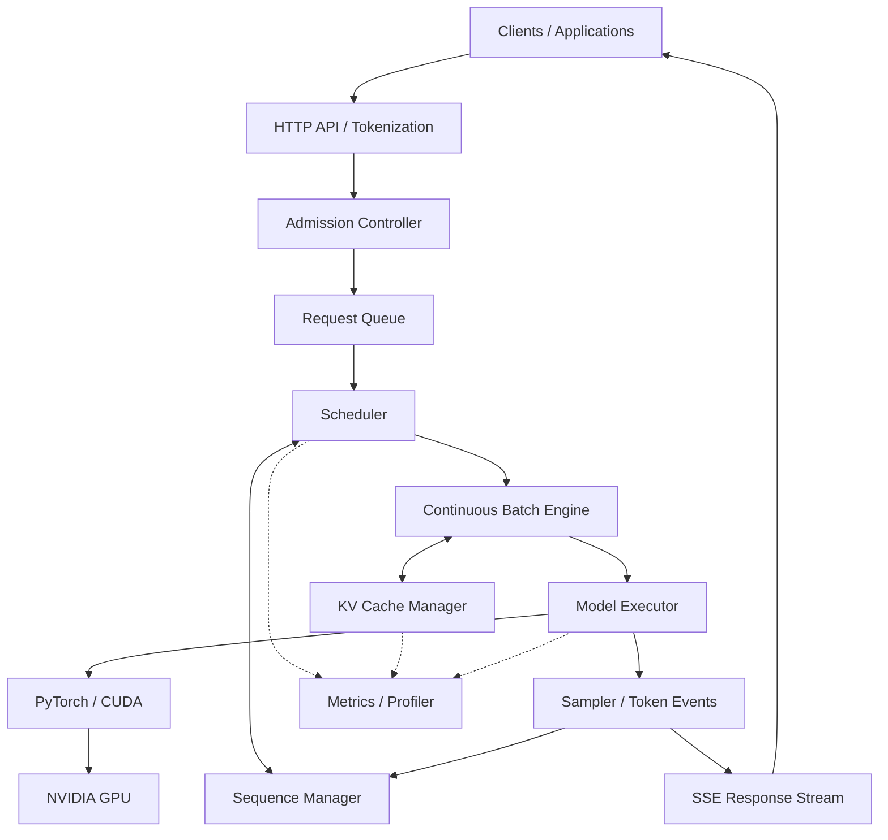

# Vortex

## Experimental LLM Inference Runtime

Vortex is an experimental, single-GPU LLM inference runtime designed to explore how decoder-only language models can efficiently serve concurrent inference requests through custom scheduling, continuous batching, explicit sequence management, KV-cache allocation, and performance instrumentation.

The project aims to expose and implement the systems mechanisms that normally remain hidden behind high-level inference APIs. Its intended use case is several clients sharing one GPU, with irregular prompt lengths, generation lengths, and arrival times.

**Status: Initial development / project setup.** Inference-runtime components are not yet implemented. The development roadmap and system design have been established; Phase 0 has not started. Capabilities and architecture described below are planned, and no performance results are available yet.

Using an existing inference engine provides a ready-made serving abstraction. Developing Vortex means owning the decisions inside that abstraction: which requests run, how batches change, where cached attention state lives, how resources are reclaimed, and how behavior is measured. PyTorch and Hugging Face Transformers are the intended model-execution foundations; Vortex will develop its own runtime control mechanisms.

## Motivation

Efficient LLM serving is a systems-engineering problem as well as a model-execution problem. Autoregressive generation repeatedly schedules useful work under finite compute and memory capacity.

- **GPU utilization:** A single request may leave accelerator capacity unused. Combining independent requests can increase useful work per iteration, while batch formation introduces overhead and waiting.
- **Prefill and decoding:** Prefill processes a prompt and populates its attention cache. Decoding advances an active sequence token by token, reusing previous keys and values. These stages have different work profiles and compete for execution time.
- **Variable request lengths:** Short requests finish while long requests continue. Fixed batches can retain unused positions; continuous batching changes membership between generation steps.
- **KV-cache growth and memory pressure:** Cached attention state grows with token count and concurrent sequences. Admission and scheduling must account for available cache capacity before execution.
- **Scheduling and fairness:** Requests need predictable ordering and bounded token and sequence budgets. Large prefills should not indefinitely delay active decoding.
- **Latency versus throughput:** Larger batches may favor total tokens per second while increasing queue time or time to first token. Both outcomes must be measured.
- **Cancellation and cleanup:** Disconnects, timeouts, failures, end-of-sequence tokens, and output limits must stop future work and release owned resources reliably.

Vortex will make these tradeoffs explicit and testable before pursuing optimizations.

## Planned core capabilities

All capabilities in this section are **planned**, rather than available functionality.

| Capability | Intended behavior |
| --- | --- |
| Custom autoregressive inference loop | Execute explicit prefill and decode forward passes with per-sequence sampling. High-level generation will serve as a baseline rather than the runtime loop. |
| Request admission and scheduling | Accept, queue, or reject work using capacity limits; begin with FIFO selection and explicit token and active-sequence budgets. |
| Sequence lifecycle management | Own request state, token history, deadlines, cancellation, terminal transitions, and idempotent cleanup. |
| Continuous batching | Let completed sequences leave and newly eligible sequences enter between generation iterations. |
| Explicit KV-cache management | Progress from model-provided cache state to measurable capacity, allocation, ownership, and reclamation policies. |
| Prefix caching | Reuse eligible attention state for exact shared token prefixes after core cache correctness is established. |
| Token streaming | Deliver ordered token events through per-request channels and propagate client cancellation. |
| OpenAI-style inference API | Provide a focused chat/completions interface with Server-Sent Events, without claiming complete API compatibility. |
| Observability and profiling | Measure queueing, generation latency, throughput, cache utilization, and CUDA memory behavior. |
| Reproducible performance benchmarks | Compare controlled workloads against sequential generation and static batching on matched hardware and settings. |

## High-level architecture



This is a conceptual diagram of responsibilities and data flow within the intended runtime. Boxes do not imply separate deployed services. Streaming delivers events on the client's response connection; it does not create a new inference request.

The API will validate inputs, tokenize prompts, expose streaming transport, and propagate disconnects. Admission control and the request queue will bound incoming work. The scheduler will select each iteration's work under policy and resource budgets, while the sequence manager owns per-request state and lifecycle.

The batch engine will materialize selected prefill and decode work into model inputs. The KV-cache manager will track capacity and cache ownership, allocate storage, and reclaim resources. The model executor will own tensor, device, and dtype handling; the sampler will turn logits into token choices. Metrics and profiling will observe these boundaries.

Scheduling, sequence, and cache abstractions will remain independent of FastAPI so their control logic can be tested on CPU with a fake executor.

## Intended technology stack

The initial implementation targets **one GPU**. This list describes the intended stack, rather than installed dependencies or verified hardware support.

| Area | Intended tools |
| --- | --- |
| Language and packaging | Python 3.11+ and `pyproject.toml` |
| Model execution | PyTorch and Hugging Face Transformers |
| Initial reference model | `Qwen/Qwen3-0.6B` |
| Accelerator execution | CUDA through PyTorch |
| HTTP interface | FastAPI and Uvicorn |
| Streaming | Server-Sent Events (SSE) |
| Runtime testing | pytest, including CPU control-plane tests and targeted GPU tests |
| Profiling | `torch.profiler`, CUDA memory APIs, and wall-clock timing |
| Benchmark analysis | JSONL/CSV artifacts, pandas, and matplotlib |
| Continuous integration | GitHub Actions for CPU checks and publication checks |

Exact model revisions, dependency versions, and execution settings will be pinned for reproducible experiments. The starter's offline setup checks use Python's standard-library test runner.

## Development roadmap

These are planned development phases, not completed milestones.

| Phase | Objective |
| --- | --- |
| 0 | Reproducible model inference baseline |
| 1 | Manual autoregressive prefill/decode loop |
| 2 | Request and sequence runtime |
| 3 | Scheduler and admission control |
| 4 | Continuous batching |
| 5 | Explicit KV-cache management |
| 6 | Prefix caching |
| 7 | Profiling and benchmarking |
| 8 | Documentation and portfolio-quality release |

Correctness comes first: establish a deterministic reference, verify the explicit generation loop, then introduce concurrent scheduling, batching, and cache policies. Performance work will require evidence that these changes preserve the intended generation and lifecycle behavior.

## Benchmarking objectives

Vortex will be evaluated against sequential Hugging Face generation and simple static batching using the same model, hardware, workload, and generation settings.

The benchmark plan includes time to first token (TTFT), time per output token (TPOT), total generation throughput, queue waiting time, end-to-end latency, p50/p95/p99 latency, GPU memory consumption, KV-cache utilization, and concurrency scaling. TTFT will cover request arrival to the first streamed output token; queue waiting will cover arrival to first scheduling. TPOT will describe output-token timing after the first token.

Workloads will vary prompt length, output length, concurrency, arrival patterns, repeated prefixes, and cancellation. Runs will record model revision, source commit, device, software versions, dtype, seed, and workload definition. Warmups, repeated trials, and dispersion will help distinguish implementation effects from measurement noise.

No benchmark numbers, speedup claims, or supported-capacity claims have been established.

## Resource constraints and development approach

Vortex is intended for experimentation on accessible hardware with small open-weight models. The control plane will be CPU-testable, reserving GPU sessions for model execution, physical cache behavior, and performance measurements.

Optional free GPU notebook environments such as Google Colab and Kaggle can provide experiment environments when available. Access and hardware are not guaranteed. Experiments should preserve their inputs, environment metadata, and results outside ephemeral notebook state. No GPU service or model download is required for the starter's CPU setup checks.

## Project status

**Status: Initial development / project setup.**

The system design and Phase 0–8 roadmap are established. Inference-runtime components are not yet implemented, Phase 0 has not started, and runtime correctness and GPU performance remain unverified.

The initial repository commit contains this README only. The local starter workspace is installed separately; its scaffolding, setup utilities, documentation, and CPU checks are not part of that initial publication.

## Project scope and non-goals

Vortex is not initially a production-ready alternative to vLLM or SGLang, a model training framework, a multi-node distributed inference platform, a custom CUDA kernel library, or a permanently hosted inference service.

The initial scope is a small, inspectable single-GPU runtime with explicit scheduling and cache behavior. Multi-GPU execution, speculative decoding, custom kernels, and production service features require later justification and are outside the initial roadmap's core goals.

## Getting started

There is no runnable inference server yet. The initial GitHub publication is documentation only.

After the starter is installed locally, consult [reproducibility and setup notes](docs/reproducibility.md), [contribution conventions](CONTRIBUTING.md), and [code-quality guidance](CODE_QUALITY.md). These files are provided by the local starter and will resolve in a public checkout only after a subsequent publication includes them.

The installed starter provides an offline, CPU-only verification command from the repository root:

```sh
python scripts/verify.py
```

This validates starter utilities and publication checks; it does not run model inference or establish runtime correctness. Model-loading, server-startup, and benchmark commands will be documented when those capabilities exist.

## License

Project licensing has not been finalized. No license grant is declared at this stage.
