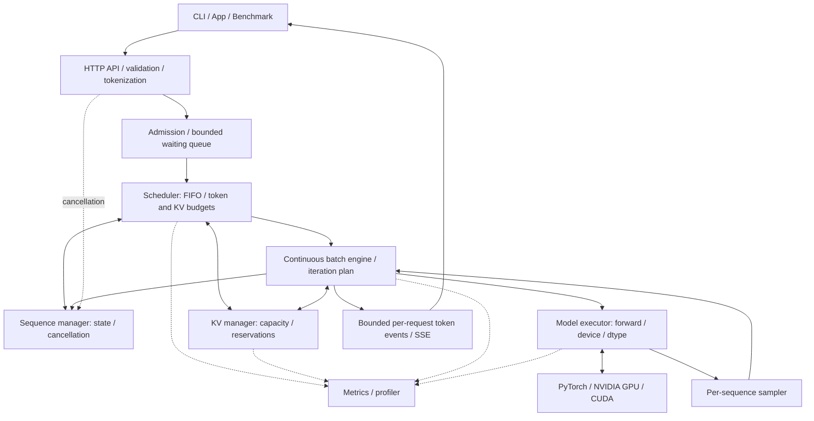
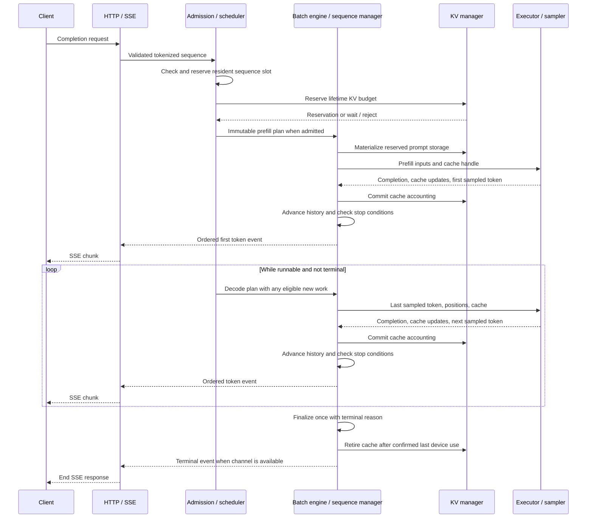
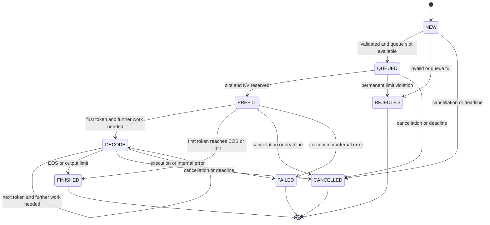

# Target runtime architecture (not implemented)

Everything below is **planned architecture**, not working runtime functionality. The package currently contains namespace scaffolding; there is no inference server, scheduler, executor or physical KV cache. Phase 0 has not started and no runtime performance or capacity results exist.

The first target is a *single-node, single-GPU* runtime for `Qwen/Qwen3-0.6B`, with Python 3.11+, PyTorch/Transformers execution and an OpenAI-style HTTP/SSE interface. Exact model revision, library versions, dtype and cache adapter remain to be selected and verified. `model.generate()` is allowed for the external baseline only, not as Vortex's engine. Multi-GPU execution, custom kernels and production service features are outside the initial scope. Spec and plan reviews precede each implementation phase.

## Components and ownership

These boxes describe responsibilities inside one process, not separate services. The engine is the orchestration role of `batching`; it coordinates one iteration at a time.

| Planned module | Owns | Boundary / invariant |
| --- | --- | --- |
| `api`, `streaming` | Request validation, chat template/tokenization, HTTP/SSE, disconnect signals | Transport does not choose work or free cache. Bounded request/event buffering; output events stay ordered per request. |
| `core` | Sequence identity, prompt/output token history, sampling settings, deadlines, state and terminal reason | One lifecycle owner; legal transitions and idempotent finalization. A terminal sequence cannot become runnable again. |
| `scheduler` | Admission decisions, bounded waiting queue, FIFO policy, token/sequence budgets | Returns an immutable iteration plan with reservations; does not run a model or depend on FastAPI. See [scheduler contract](scheduler.md). |
| `batching` | Iteration orchestration, materialization, result routing | Preserves request identity as rows enter/leave batches; commits successful cache/state updates before publishing output. |
| `cache` | Capacity accounting, reservations, block tables, storage lifetime | Exclusive mutable ownership initially; reuse only after the executor confirms last device use. See [KV contract](kv-cache.md). |
| `executor` | Model forward, tensor shapes, masks, positions, device/dtype, execution completion; sampling | Accepts explicit inputs/cache handles and returns logits/cache updates tied to request IDs. Sampler uses each sequence's settings independently. |
| `metrics` | Boundary timestamps, counters, profiling observations | Observes decisions rather than changing them; measured claims require recorded hardware/workload evidence. |

Interfaces above are proposed contracts, not existing Python symbols. Runtime state, scheduling and logical allocation must be testable on CPU with a fake executor. Real tensor, attention and CUDA behavior needs separate GPU verification.

## Request lifecycle and streaming

1. The planned `POST /v1/chat/completions` boundary validates request size, model selection and generation limits, applies the pinned tokenizer/chat template, and assigns a request ID. Only validated, tokenized work enters the bounded queue; queueing does not reserve GPU residency.
2. Admission rejects permanently invalid/oversized work or a full queue. Temporarily unavailable slots or KV capacity leave eligible work queued under a deadline. The scheduler rechecks cancellation, budgets and capacity before selecting prefill.
3. The engine materializes a reserved plan. Prefill processes the prompt and populates its cache; final prompt logits produce the **first output token**. That sampled token is not yet cached: the next decode forward consumes it at the next position to predict the following token.
4. After execution completes successfully, the engine reconciles cache updates, advances sequence history/state, and publishes ordered token events. A first token that meets EOS/output limits finishes immediately; otherwise the sequence becomes `DECODE`.
5. Each later iteration may select one decode input token per active sequence and admit compatible new prefills. Completed sequences leave between iterations. Continuous batching does not mean every mixed prefill/decode plan fits one tensor call; the executor may use separate micro-batches under the same budget.
6. SSE transports events on the original response connection. Disconnects, deadlines and bounded-channel backpressure stop future scheduling. Terminal events carry a reason; cleanup retires owned resources after outstanding device use, even if the client cannot receive the final event.

This sequence diagram shows the successful path; failures and cancellation use the terminal rules below.

## Sequence state machine

The design's baseline states are `NEW`, `QUEUED`, `PREFILL`, `DECODE`, `FINISHED`, `CANCELLED` and `REJECTED`. **Proposed clarification:** add `FAILED` for execution/internal errors so failure is not reported as successful completion. This is a documentation refinement; no enum or transition code exists yet. Timeouts use `CANCELLED` with a distinct reason. HTTP validation can reject before a sequence exists.

`PREFILL` denotes admitted prompt work, not proof that a CUDA kernel is currently running. Terminal state stops new work immediately; it does **not** prove memory is reusable. Execution completion and resource retirement are tracked separately. Repeated cancellation/finalization must not emit duplicate terminal events, release a slot twice, or double-free blocks.

## Iteration correctness and recovery

The planned engine serializes lifecycle mutation at iteration boundaries. External handlers signal cancellation; they do not mutate an in-flight plan or directly reclaim its cache. Recheck cancellation before submission and before publishing returned tokens. If cancellation wins before publication, discard that result for the client and retire it safely.

Before device submission, a materialization failure rolls back unused reservations and records an actionable error. After submission, cache writes may be partial or asynchronous: do not assume rollback restores valid attention state. Fail affected sequences, suppress uncommitted output, and retain/quarantine storage until completion is established. A poisoned or uncertain executor must stop new admission/execution; unaffected work may continue only when isolation and executor health are established. No unlimited OOM retries, silent token skipping or automatic replay of partially streamed requests.

Tensor materialization must preserve token order, cache length, causal masks and per-sequence positions across padding and changing batch rows. Greedy sampling comes first; later stochastic sampling needs per-request random state. Future verification must compare token IDs against a pinned trusted baseline, including batched/unbatched runs, request isolation and cancellation. CPU allocator tests cannot establish those properties.

Queue time runs from arrival to first scheduling; TTFT runs from arrival to first streamed output; TPOT describes output cadence after that first token. These are intended measurement boundaries, not available measurements. See [engineering conventions](../CODE_QUALITY.md) and [contribution workflow](../CONTRIBUTING.md).
