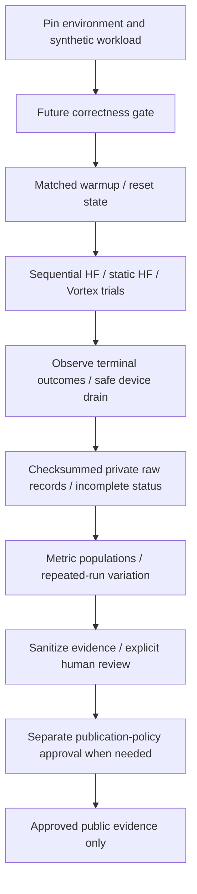

# Benchmark protocol

**Planned protocol; no benchmark runner, runtime measurements or performance results exist yet.** Separate correctness from performance: a variant must first pass the relevant [integration](../tests/integration/README.md) and [GPU correctness](../tests/gpu/README.md) checks. These checks are themselves planned. A faster incorrect output is not a serving improvement.

## Comparable systems and workloads

Compare sequential Hugging Face, static batching and each implemented Vortex variant on **the same GPU, model/tokenizer revision, precision, generation settings and workload manifest**. Record any deliberate difference, such as batching or cache policy, as the variable under study. The initial reference model is `Qwen/Qwen3-0.6B`; its exact revision and execution configuration are not selected yet.

| Planned system | Work contract |
| --- | --- |
| Sequential HF | One `model.generate()` request at a time; concurrent offered requests wait in the same measurement adapter. Queue time must include that wait. |
| Static batch HF | Fixed membership for each generation batch. Declare batch size, arrival-order grouping, maximum formation wait, padding/masking and per-request stopping. Finished rows cannot be counted as useful generation while the batch drains. |
| Vortex variant | Explicit prefill/decode runtime loop with the variant's declared scheduler, token/sequence budgets and KV policy. Continuous membership changes occur between iterations. |

Use the same synthetic request IDs, tokenized prompts and output limits for each comparison cell. Start with greedy token-ID parity; do not compare different chat templates, EOS rules, quantization or sampling settings as if only scheduling changed. Record actual output lengths and exclude prompt/padding/terminal-only control tokens consistently from reported output-token counts.

Run two distinct load modes: a fixed **open-loop arrival trace**, independent of completions, and a **closed-loop concurrency** sweep whose clients submit the next request after a terminal outcome. Their results must not be pooled. Closed-loop arrival times naturally differ across systems; its comparable controls are client count, request sequence and replenishment rule. Open-loop runs must record intended versus actual arrivals and load-generator delays, so an overloaded driver is not mistaken for a fast server. See the [workload manifest contract](../benchmarks/workloads/README.md).

Cancellation and prefix reuse need separate scenarios. If a baseline cannot interrupt generation or expose a metric, report that capability as unsupported/NOT VERIFIED rather than assigning it a zero or a fabricated equivalent. Keep comparisons to measurements that share the same observable boundary.

## Metric definitions

Use one monotonic server/adapter clock for `a` (actual request arrival), `s` (first scheduling), `t1 ... tn` (ordered output-token events emitted to the response channel), and `f` (terminal outcome observed after the last output event). Declare this instrumentation boundary for every engine. Record client arrival/receipt/connection-end timing separately on a client clock; do not subtract timestamps from different machines or label internal sampling time as streamed TTFT. Coalesced SSE chunks or text decoding may not expose individual token times: use token-event instrumentation or mark token cadence unavailable.

| Metric | Definition / unit / missing case |
| --- | --- |
| TTFT | `t1 - a`, seconds to first streamed output-token event. No emitted output means unavailable, with outcome/reason retained. |
| Queue latency | `s - a`, seconds to first scheduling; includes validation/admission and waiting under this boundary. Unscheduled requests have no queue-latency sample. |
| End-to-end latency | `f - a`, seconds to terminal outcome. Keep successful, cancelled, rejected and failed populations separate; device retirement time is recorded separately. |
| TPOT | Per-request mean `(tn - t1) / (n - 1)`, seconds/output token after the first. `n < 2` means unavailable, never zero. Also retain individual inter-token gaps as a separate distribution. |
| Throughput | Actual output tokens emitted during a declared trial divided by trial wall seconds. Report both total emitted tokens and the subset from successfully completed requests; include attempts/outcomes so cancelled output cannot masquerade as successful goodput. |
| Request rates | Offered, admitted and successfully completed requests/second, with explicit denominators and the same trial window. Report rejection/failure/cancellation counts and rates over all attempts. |
| GPU memory | Report resident baseline, absolute peak allocated bytes and absolute peak reserved bytes separately for the selected device; label any incremental peak explicitly. Do not add the baseline to an absolute peak that already includes it. Optionally report device-wide usage from a named tool; distinguish allocator reservation, process tensors, total device memory and host RAM. |
| KV utilization | Time series/peak of unavailable KV blocks divided by pool blocks, partitioned into reserved/owned and retiring capacity without double-counting. Also report populated cached tokens and capacity. A baseline without block telemetry is unavailable, not zero. |
| Cancellation | Cancellation signal to scheduling stop and to safe resource retirement, separately. Record tokens/work after the signal, cancel-before-prefill versus active-decode cases, and timeouts as cancellation reasons. |
| Concurrency scaling | Offered clients, queue depth, resident sequences, rate, latency, outcomes and memory per concurrency point. Offered concurrency is not necessarily active GPU concurrency. |

For an open-loop finite trial, start at the first intended arrival and stop only after all attempts have a terminal outcome **and** outstanding device work/resources are retired. Closed-loop trials use a predeclared request count or duration and the same explicit drain rule. Include idle gaps, queueing and drain in the wall window. If interrupted, retain it as incomplete; report an explicitly bounded partial window separately, never as a completed run.

Compute empirical p50/p95/p99 separately per metric, scenario, system and repetition. Use nearest-rank quantiles: sort `N` valid samples and select one-based index `ceil(p * N)` for `p = 0.50, 0.95, 0.99`; empty populations are unavailable. Publish sample counts and missing/outcome counts. TPOT percentiles over per-request means and percentiles over all inter-token gaps are different statistics and must be labelled. Report between-repetition variation; do not average percentile values and call them a pooled percentile. Small samples do not establish tail guarantees, and dropping cancellations or failures from a latency plot requires adjacent counts/outcome distributions.

## Warmup, timing and repetition

Pin the [environment/run metadata](reproducibility.md#run-record) and predeclare warmup count/criterion, measured request count or duration, and repeat count. Plan at least three separately reset measured repetitions per cell; this is a minimum descriptive protocol, not a statistical confidence guarantee. Increase evidence when dispersion or tail claims warrant it, within authorized resource limits.

Load/download/setup are outside steady-state inference timing; cold-start costs are separate experiments. Warm every compared method consistently, drain warmup work, then reset counters, peak statistics and per-request state. Declare whether prefix caches are empty or intentionally warm; ordinary model warmup must not secretly warm only Vortex's measured prefixes. Repeat at matched settings, alternate method order to reduce drift, and retain every trial and exclusion reason rather than selecting the best run.

CUDA submission is asynchronous. Host end-to-end measurement must observe actual completion at the trial boundary; device-region timings need appropriately ordered CUDA events or synchronization outside the region. Do not insert global synchronization after every token solely to measure a concurrent service: it changes overlap and the workload. Keep wall-clock and device-region results distinct. See [PyTorch CUDA semantics](https://docs.pytorch.org/docs/stable/notes/cuda.html).

Collect profiler traces in separate labelled runs: instrumentation, console printing and artifact export can distort latency. Report attention backend/compilation and deterministic settings; seeds alone do not ensure identical outputs across releases or devices. Do not pool GPU types or treat different notebook sessions as controlled implementation-only comparisons. Rerun all compared methods on the new hardware/session and retain session identity when availability changes.

## Evidence and publication

No speedup, supported capacity or numerical result is asserted by this protocol. Retain raw events, manifests, output checks and environment records in operator-controlled private storage. Only separately approved sanitized evidence may be published, following the [results policy](../results/README.md); current policy permits only its README under `results/`.

