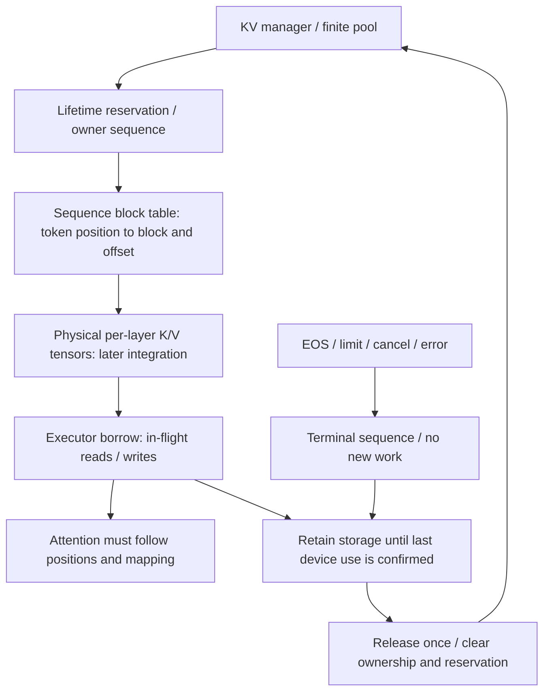

# KV memory — planned progression

**Planned, not implemented.** Vortex has no KV allocator, tensor pool, prefix cache or paged-attention implementation yet. CPU bookkeeping will be verified separately from real GPU storage and attention. See [architecture and lifecycle](architecture.md) and [admission/scheduling](scheduler.md).

## Evolution and proof boundaries

| Stage | Planned mechanism | Required evidence before claiming it works |
| --- | --- | --- |
| A | Inspect model-provided `past_key_values` per sequence | Cache representation, per-layer shapes, positions, dtype/device and greedy token parity with a pinned baseline. |
| B | Explicit lifetime/capacity accounting and preallocated per-sequence regions | Measure resident allocation/growth and reserve capacity before admitting work; region layout must work with the selected model/cache adapter. |
| C | Logical fixed-size block pool, free list and ownership | CPU allocation/reclamation, exhaustion, rollback, request isolation and double-free checks. This stage alone does not change GPU attention. |
| D | Block tables mapping logical token positions to physical K/V storage | Demonstrate actual tensor writes/reads and attention following the mapping, correct masks/positions and batched/unbatched parity. Indirection metadata alone is insufficient. |
| E | Optional exact shared-prefix caching | Cache identity, reference counting, immutable shared blocks or copy-on-write, invalidation and token correctness tests. Deferred until core ownership is sound. |
| F | Stretch eviction/offload experiments | Explicit progress policy, transfer/device-lifetime safety and recovery evidence. Outside the initial baseline. |

The exact adapter, tensor layout and attention mechanism are undecided. `past_key_values` is a model/library interface, not a guarantee of a legacy tuple format. Its shape and update behavior must be checked against the versions selected for the experiment. A simulated allocator is not a paged-attention kernel, and a block table does not make an unmodified model forward understand arbitrary pages.

## Capacity model

For a standard full-context decoder-only transformer with uniform layers, the approximate payload bytes per cached token are:

```text
bytes_per_token = 2 * layers * kv_heads * head_dim * bytes_per_element
payload_bytes   = cached_tokens_across_sequences * bytes_per_token
```

The leading `2` counts both K and V; use **KV heads**, not query heads, for grouped-query attention. Derive dimensions from the selected model configuration and validate actual tensors instead of hardcoding model values. The estimate excludes weights, activations, attention workspace, allocator overhead, reserved CUDA memory and fragmentation; it is not a total VRAM or OOM guarantee. Different layer/cache strategies require their own accounting.

For block size `B` tokens, a conservative lifetime reservation is `ceil((P + G) / B)` blocks per resident sequence. This is the proposed [scheduler baseline](scheduler.md#admission-and-capacity); actual initialized cache positions track **processed input tokens**, not every sampled output. Prompt prefill caches `P` tokens and samples output token one; each subsequent decode consumes the previous sampled token and adds its K/V. After `g >= 1` outputs in the ordinary one-token loop, initialized positions are `P + g - 1`. The final output need not be forwarded just to fill a reservation. Capacity reserved and capacity populated must remain separate counters.

Define a dedicated KV budget only after allowing for model residency, peak workspace and a measured safety margin. Reservations must include partially filled last blocks and capacity awaiting safe retirement; logical free capacity is not the same as the CUDA allocator's free/reserved byte counts. Preallocated storage remains allocated on the GPU even when its blocks return to the logical free list. Monitor both logical utilization and physical allocated/reserved memory.

## Ownership and retirement

Initially, each mutable cache region/block belongs to exactly one sequence. The KV manager owns the pool and authoritative mapping; a sequence holds handles, not permission to bypass the manager. An executor borrows storage for a specific in-flight operation. Terminal state removes scheduling eligibility but does not immediately remove that borrow.



The storage/attention path is the target for stage D; earlier stages may use model-owned per-request storage instead. The diagram does not claim a block-aware kernel already exists.

Planned invariants:

- Every block is free, reserved/owned, or awaiting retirement; categories cannot overlap. Free, resident/reserved and retiring capacity reconcile to the configured pool without double-counting populated storage within a reservation.
- A logical position maps to one valid owner-authorized block/offset. Two requests must never share mutable attention state. Batch row changes cannot change ownership or positional semantics.
- Capacity is reserved before use. Allocation/materialization failure releases unused reservations; after device submission, uncertain writes require failure/retirement, not blind rollback and reuse.
- Finish, cancellation, timeout and error converge on idempotent retirement. Remove handles only after the executor establishes safe last use; keep failed/uncertain regions quarantined rather than handing them to another request.
- Python task cancellation or return from an asynchronous CUDA submission is not device completion. The executor must implement appropriate stream ordering/completion and tensor lifetime handling before reuse. See [PyTorch CUDA semantics](https://docs.pytorch.org/docs/stable/notes/cuda.html).
- CPU control-plane tests can prove accounting and lifecycle rules. Physical layout, masks, cache positions, parity and safe CUDA reuse require targeted integration/GPU evidence. See [Transformers caching explanation](https://huggingface.co/docs/transformers/cache_explanation).

Shared-prefix reuse is deferred. A future key must identify exact token IDs plus model revision, positional context and execution/cache settings that affect K/V; a text hash alone is insufficient. Shared blocks must be immutable while referenced, retain their own lifetime references and use copy-on-write when needed. Eviction cannot recycle referenced or in-flight storage. No hit-rate, memory-saving or speedup claim exists.
