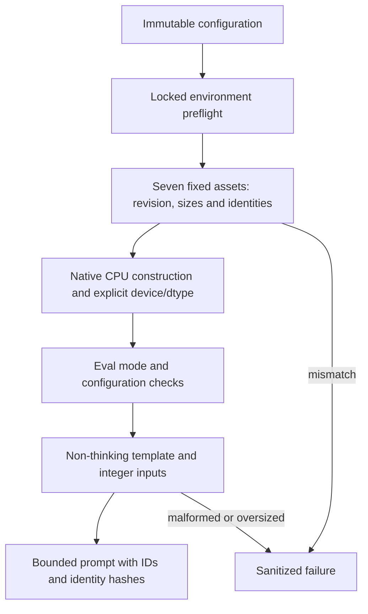
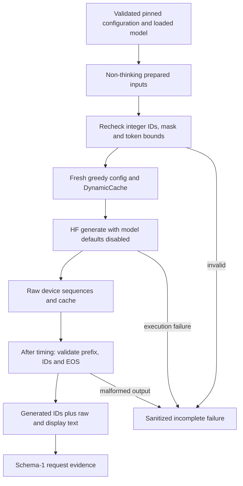
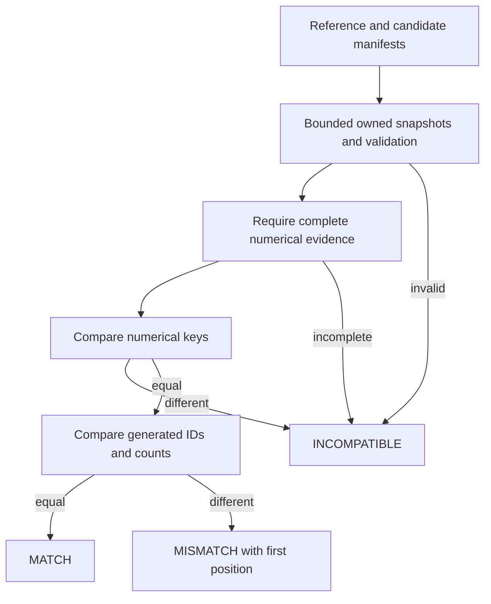
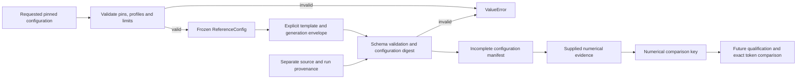

# Reference configuration, loading, generation and manifest contract

The reference configuration and schema validators run offline with Python's
standard library. They do not load a model, import inference libraries, probe
devices or qualify an environment. Optional loading and HF generation adapters
are separate from those validators. Real pretrained execution, golden token
capture and measurements remain NOT VERIFIED.

## Immutable intended configuration

`vortex.executor.reference_config.ReferenceConfig` is a frozen dataclass. Its
constructor and `validate_reference_config(config)` raise `ValueError` for
unsupported settings, without resolving aliases or changing the request.

Both the model and tokenizer use repository `Qwen/Qwen3-0.6B`, at commit
`c1899de289a04d12100db370d81485cdf75e47ca`. A different full SHA also requires a
reviewed contract change. Branches, tags, abbreviated SHAs and revision mismatch
are rejected.

| Profile identity | Intended device | Intended dtype | Attention |
| --- | --- | --- | --- |
| `windows-cpu` | `cpu` | `float32` | eager |
| `t4-fp16` | `cuda:0` | `float16` | eager |

These are intended profiles, not execution support claims. The
[environment contract](reference-environment.md) records complete dependency locks
and verified Windows imports. Actual model loading, driver support and FP16
execution remain NOT VERIFIED. No automatic device, dtype or backend selection is permitted.
BF16 and other devices require separately reviewed profiles.

The prompt limit counts tokens **after** chat templating. Integer limits are
inclusive: 1–512 prompt tokens and 1–64 newly emitted tokens, at most 576 total.
The default output cap is 32; EOS can finish earlier. Reject oversized prompts
instead of truncating them. Booleans and floating point values are not integer
token counts. This reference uses integer seed zero.

The initial workload consists of these three independent user messages,
each with a nominal 32-token output cap:

- `Reply with the single word vortex.`
- `What is 2 + 2? Answer briefly.`
- `Explain a key-value cache in one short sentence.`

There is no system message or thinking suffix. `tokenize=True`,
`add_generation_prompt=True` and `enable_thinking=False` are required. The
template's empty thinking block belongs to the input identity. Eager attention,
no autocast/quantization/compilation, and a fresh model-owned `DynamicCache` per
request are the intended execution contract. The loader enforces explicit eager
loading; the generation adapter enforces settings and per-request cache ownership.

## Loading and prompt preparation

`vortex.executor.reference_loading` imports without Torch, Transformers, Hub,
network access or model assets. Its public operations are:

```python
load_reference(config: ReferenceConfig, *, offline: bool = False) -> LoadedReference
prepare_prompt(loaded: LoadedReference, messages: Sequence[Mapping[str, str]],
               config: ReferenceConfig) -> PreparedPrompt
```

These signatures describe the contract; invoking loading is a separate execution
action. Local development uses synthetic assets and factories. Real pretrained
loading requires a separately authorized host and the matching installed profile.
Do not run a pretrained model on the local development laptop. No actual loading,
weight acquisition or forward execution was performed to validate this adapter.

The loader validates the immutable configuration and boolean offline flag before
I/O. It reuses the existing environment verifier in a bounded isolated process
with the current interpreter, requiring the complete installed profile, receipts,
imports and API checks. The reviewed source checkout and its environment utility
must be present; an installed namespace-only package is insufficient. This
preflight is an import check, not full execution qualification. Before importing
native packages in the calling process, the loader also binds every locked
distribution's import roots to this interpreter's site-packages and rejects
shadowed or preimported foreign roots. This covers ordinary import-path drift,
not arbitrary malicious monkeypatching inside an already compromised process.

The asset boundary is a dedicated private Hub cache outside the public checkout,
selected through normal `HF_HOME`/`HF_HUB_CACHE` configuration before dependency
imports. The cache must be operator-controlled and non-shared. Do not reuse a
snapshot containing arbitrary files from a broad download. The only accepted
snapshot entries are:

- `config.json`
- `generation_config.json`
- `tokenizer_config.json`
- `tokenizer.json`
- `vocab.json`
- `merges.txt`
- `model.safetensors`

Each fixed-file request supplies the exact repository/revision, `token=False`, an
ETag timeout and `local_files_only=offline`. There is no online retry after an
offline miss and no `local_dir`, arbitrary filename, source-code discovery, shard
index or alternate-format fallback. Existing cache-directory symlinks/reparse
points and returned-path escapes are rejected. Normal snapshot-to-blob symlinks
are accepted only inside the same reviewed model cache. Unexpected sidecars,
including `chat_template.jinja`, custom code, pickle or shard indexes, fail closed.
Pre-download checks also cover the model's lock, incomplete-blob and negative-cache
write areas. Directory enumeration is bounded; shared or cluttered caches should
use a new dedicated location, without deleting existing operator data.

Before any HF configuration/tokenizer/model parser reads an asset, the loader
checks its exact size and immutable identity from the
[pinned repository tree](https://huggingface.co/Qwen/Qwen3-0.6B/tree/c1899de289a04d12100db370d81485cdf75e47ca).
The three JSON SHA256 values and decoded template SHA256 match the schema-1
manifest contract. LFS SHA256 identifies the full `tokenizer.json` and
`model.safetensors` bodies, never their pointer files. Vocab and merges use the
reviewed Git blob SHA1, including its size/header; their computed body SHA256
values are recorded as evidence. A hash binds content, not general file safety.

`tokenizer_assets_sha256` is the canonical digest of a filename-to-body-SHA256
object for `tokenizer_config.json`, `tokenizer.json`, `vocab.json` and `merges.txt`.
`weights_sha256` is the canonical digest of
`{"model.safetensors": <verified body SHA256>}`. `LoadedReference.assets`
supplies these plus the four schema-known hashes. Configuration and asset identity
are preserved separately from future run/source provenance; no complete run
manifest or golden output is manufactured by loading.

After byte validation, raw metadata rejects private attention/backend hooks,
remote mappings and quantization/adapter/custom-generation entry points. Native
Qwen3 dimensions, architecture and the saved dual EOS policy must match the
reference. Native `Qwen3Config` and `GenerationConfig` objects are passed explicitly
to loading. The saved generation config is evidence only; this adapter never
executes it or adopts it as the future greedy generation policy.

Tokenizer/model factories receive the audited local snapshot, pinned revision,
`trust_remote_code=False` and `local_files_only=True`. The tokenizer must be fast,
have the reviewed template and resolve the expected control IDs. The model uses
`use_safetensors=True`, explicit `torch_dtype` and `attn_implementation="eager"`,
is constructed in a CPU device/inference-mode context, moved explicitly to the
requested device/dtype and put in `eval()`. Actual parameter devices/dtypes,
configuration and eager selection are checked; no automatic device map, offload,
autocast, quantization or alternate backend is accepted.

Loading's inference mode is scoped. Future separately implemented execution must
enter `loaded.inference_context()` again; returning a model does not disable
autograd globally. The caller owns returned model/tokenizer objects and mutable
input tensors. Failure drops partial local references without retaining raw
dependency exceptions; caches are retained and never deleted. Allocator-reserved
memory release is not guaranteed. Native construction/transfer is synchronous,
without a hard wall-time or memory bound; there is no adapter retry loop.

Prompt preparation accepts one nonempty user message, including each of the
three fixtures. It snapshots the input, bounds text to 16,384 codepoints/64 KiB,
and rendered text to 64 KiB before processing tensors. It uses the pinned chat
template with `add_generation_prompt=True`, `enable_thinking=False`,
`tokenize=True`, `return_tensors="pt"`, `return_dict=True`, `padding=False`,
`truncation=False` and an explicit attention mask. The empty thinking block stays
in the input identity. Thinking mode changes input tokens and comparison identity;
the nominal 32-token output cap is unsuitable for an unbounded thinking workflow.

The result must contain integer `int64` input IDs and an all-one mask with shape
`[1,P]`, where `1 <= P <= config.max_prompt_tokens <= 512`. Render-then-tokenize
replay uses `add_special_tokens=False` and must produce identical IDs, preventing
duplicate special tokens or drift. Transfer specifies only the selected device,
preserving integer dtype. `PreparedPrompt` retains CPU IDs, rendered text/hash
and the canonical messages digest for later manifest assembly. Both EOS IDs stay
in `LoadedReference.eos_token_ids`; prompt preparation does not replace them with
the tokenizer's single EOS or forward generation settings into tokenization.

Failures expose finite `ReferenceLoadingError.code` values for invalid config,
environment mismatch, invalid/missing assets, model/template mismatch, loading
failure, OOM or malformed prompts. Messages contain neither prompts nor native
diagnostics, paths or credentials. Keyboard interruption propagates normally.

Security review of the pinned stack remains deliberately bounded. The
[Transformers kernel-loading bypass](https://github.com/advisories/GHSA-29pf-2h5f-8g72)
requires excluding optional kernels and rejecting private attention metadata;
eager or `trust_remote_code=False` alone is insufficient. Explicit native
generation configuration and a closed local snapshot exclude custom-generation
discovery. Fixed filenames/cache containment exclude Hub's broader
[local-directory acquisition risks](https://github.com/huggingface/huggingface_hub/releases/tag/v1.26.0).
No Hub checkpoint helper, arbitrary shard index, pickle, Trainer, TorchScript,
export or tokenizer-save path is used. This is not a clean-security certification.
The implementation assumes no malicious concurrent mutation by the same account
after validation; do not use an adversary-writable cache.

Verification commands:

```sh
python -m unittest discover -s tests/unit -p "test_reference_loading.py" -v
python scripts/verify.py
```

The opt-in `tests/integration/test_reference_loading.py` uses the existing locked
CPU environment with `VORTEX_REFERENCE_TOKENIZER_API=1`. It tests the real
Transformers 4.53.3 chat-template API with a tiny synthetic tokenizer, controlled
artifact identities and small CPU input tensors. It never calls `load_reference`
or constructs a model. Passing it verifies API compatibility only, not the real
Qwen tokenizer, full asset hashes, pretrained loading, GPU/FP16, generated IDs,
numerical parity or performance. Those remain **NOT VERIFIED**. The generation
adapter below is tested separately; no custom decoding loop is implemented.



## Bounded Hugging Face reference generation

`vortex.executor.reference_generation` imports without inference dependencies.
Its APIs consume a matching validated `ReferenceConfig`, `LoadedReference` and
`PreparedPrompt` from the loading adapter:

```python
generate_raw_reference(loaded, prompt, config) -> RawGenerationOutput
materialize_generation(raw, loaded, prompt, config) -> GenerationResult
generate_reference(loaded, prompt, config) -> GenerationResult
```

The convenience operation composes raw generation and materialization for untimed
correctness work. It is the HF reference baseline, not Vortex's decoding engine.
No weights are acquired by these functions. Real Qwen generation and GPU execution
have **NOT BEEN VERIFIED**. Use only synthetic fixtures on the development laptop;
real execution requires a separately authorized host and reviewed assets/profile.

Each call constructs a new native `GenerationConfig` and passes
`use_model_defaults=False`. The second control is essential in
[Transformers 4.53.3](https://github.com/huggingface/transformers/blob/v4.53.3/src/transformers/generation/utils.py):
otherwise fields equal to library defaults may be replaced from saved model
defaults. A saved `do_sample=True`, temperature `.6`, top-p `.95`, top-k `20`
therefore cannot change this comparison into sampling.

| Explicit settings | Purpose |
| --- | --- |
| `do_sample=False`, one beam/group/return sequence | One greedy request, without sampling or beam alternatives |
| `max_new_tokens=G`, `min_new_tokens=0` | At most G new tokens, with EOS allowed immediately |
| `max_length=P+G`, `min_length=P` | Record the same normalized lengths used internally by the pinned library |
| `eos_token_id=[151645,151643]`, `pad_token_id=bos_token_id=151643` | Preserve both approved stops and prevent special-ID fallback |
| `temperature=top_p=1.0`, `top_k=50` | Neutral, inactive sampling defaults retained as numerical evidence |
| `repetition_penalty=length_penalty=1.0`, `no_repeat_ngram_size=0` | No repetition or length preference |
| `use_cache=True`, fresh `DynamicCache`, `logits_to_keep=1` | Isolated request state and the approved last-position projection |
| Return dictionary; scores/logits/attentions/hidden states disabled | Return sequences/cache without retaining extra diagnostic tensors |
| Empty custom processors/stopping criteria; no streamer, assistant, custom generator or `max_time`; `synced_gpus=False` | No caller-supplied execution hooks, string stops, distributed coordination or time-based early stop |

The decoder-only path explicitly forwards `decoder_start_token_id=None` after
default preparation. No arbitrary generation kwargs are accepted. Full native
`GenerationConfig.to_dict()` evidence, including inactive fields/version, is
serialized after generation; invocation controls stay in the schema's generation
envelope. Saved model defaults are not mutated. Non-thinking mode belongs to
prompt preparation (`enable_thinking=False`), never to an unsupported generate kwarg.

Before execution, mutable input tensors are rechecked against their bounded CPU
ID tuple, with integer `[1,P]` shape, explicit device and an all-one mask. Limits
remain P <= 512 and 1 <= G <= 64, without truncation. The model must still be in
eval mode with the matching eager profile. Calls enter a fresh inference context.
Callers must serialize access and avoid concurrently mutating model/input objects.

The raw result owns device sequences, its fresh cache and native configuration.
Raw generation does no `.cpu()`, `.tolist()`, output slicing, decoding or record
serialization. It includes validation, dependency/import checks and cache/config
construction; any future interval timing that entire operation must say so.
Synchronization and measurements are not implemented here. After timing,
materialization checks integer `[1,P+g]` output, exact prompt prefix, vocabulary
membership and `1 <= g <= G`, then extracts `sequence_ids[P:]`. Prompt IDs are
never counted as output. The returned cache must be that request's `DynamicCache`
with observed sequence length `P+g-1`; full per-layer cache inspection is separate.

Both terminal EOS IDs remain in `generated_ids`. Tokens after an EOS and short
non-EOS output are rejected. EOS wins when it coincides with G, while
`reached_limit=True` independently records the cap. Raw decode uses
`skip_special_tokens=False`; display decode uses `True`; both use
`clean_up_tokenization_spaces=False`. Display text is never the parity oracle.

`GenerationResult` contains `prompt_ids`, `sequence_ids`, `generated_ids` as tuples,
`raw_text`, `display_text`, `stop_reason`, `reached_limit` and full
`effective_generation_config`. Convert tuple IDs to JSON lists for schema 1.
Finite `ReferenceGenerationError.code` values distinguish invalid config/prompt,
environment mismatch, invalid output, failed execution and OOM. Failures return
no successful output; no retry, token trimming or fallback occurs. Interruptions
propagate. The convenience function drops its local raw/cache reference on exit;
raw API callers own release. Native calls have token bounds, not hard wall-time
or memory guarantees. No allocator reclamation or concurrency isolation is claimed.

### CLI and verification

`benchmarks/workloads/phase0-prompts.json` contains the three fixed synthetic
messages A/B/C with nominal G=32. The CLI verifies their exact schema/content.
Its default is configuration-only: it emits three schema-valid drafts with null
numerical evidence/outputs and `complete=False`, without loading dependencies or
assets. A draft has no tokenized workload identity yet. Source provenance is
operator-supplied; use the actual reviewed commit and dirty/patch evidence.

```sh
python benchmarks/run_baseline.py --help
python benchmarks/run_baseline.py --profile windows-cpu --source-sha "$(git rev-parse HEAD)"
python -m unittest discover -s tests/unit -p "test_reference_generation.py" -v
python scripts/verify.py
```

Future execution command, **only on a separately authorized host**, with reviewed
cached assets and the matching profile (not executed during development):

```sh
PYTHONHASHSEED=0 CUBLAS_WORKSPACE_CONFIG=:4096:8 python benchmarks/run_baseline.py \
  --profile t4-fp16 --source-sha "$(git rev-parse HEAD)" --workload A --execute --offline
```

The CLI rejects missing early environment settings before loading, sets seed zero
for Python/NumPy/Torch, disables cuDNN benchmark/TF32 and enables strict deterministic
algorithms. It emits one validated schema-1 manifest per request. `complete=True`
means only that the request returned valid adapter output, not that the environment
or pretrained outputs are independently qualified. Failure/interruption emits an
incomplete manifest and finite stderr code; prior completed lines are retained.
Exit codes: 0 drafts/request success, 2 invalid preflight/arguments, 3 request failure,
130 interruption. Keep stdout captures outside the public checkout; no durable
export, timing, golden comparison or automatic publication is implemented.

`tests/integration/test_reference_generation.py` is opt-in with
`VORTEX_REFERENCE_GENERATION_API=1` inside the existing locked CPU environment. It
uses real 4.53.3 configuration/default-preparation and `DynamicCache` APIs, tiny
Torch tensors and a stub generation call. It never constructs Qwen, calls a model
forward, downloads weights or runs actual HF decoding. Unit/mock determinism and
this API check are not evidence of pretrained token correctness. Actual Qwen
tokenizer/model loading, EOS/cache behavior, native Linux/CUDA/FP16, repeated token
parity and performance remain **NOT VERIFIED**.



## Offline token comparison

`scripts/compare_reference.py` implements the standard-library-only contract:

```python
compare_reference(expected: Mapping[str, object], actual: Mapping[str, object]) -> ComparisonResult
```

Inputs are schema-1 manifests, not bare token lists or decoded strings. Each input
is copied through the existing bounded canonical JSON snapshot and validated before
use. No caller-owned mapping is reread after validation and no input is mutated.
The comparator additionally enforces the pinned vocabulary range `0 <= ID < 151936`
for prompt and generated IDs. No model, tensor, GPU, network or inference package
is needed. Tests use controlled synthetic records, not qualified pretrained goldens.

Comparison has three separate concerns:

1. **Numerical comparability:** both manifests must be valid, complete and contain
   numerical evidence. Their recomputed `comparison_key_sha256` values must match.
   This covers configuration, input IDs/template/assets, full effective generation
   configuration, environment/build/wheel/hardware evidence and determinism.
2. **Provenance:** source commit/dirty patch, adapter version, run/session IDs and
   timestamp remain required and validated. Differences in those fields alone do
   not prevent numerical comparison. Source changes still require review and later
   requalification before accepting a new golden.
3. **Outcome:** eligible generated token lists and their lengths are compared
   exactly, including terminal EOS. Equal configuration digests or numerical keys
   alone cannot produce a match. Decoded raw/display strings are not compared.

`ComparisonResult` is a frozen dataclass with exactly these report fields:

| Field | Meaning |
| --- | --- |
| `status` | `MATCH`, `MISMATCH` or `INCOMPATIBLE` |
| `first_mismatch` | Zero-based position in generated IDs, including EOS; otherwise `null` |
| `reason` | Finite machine-readable reason code, without raw inputs or native diagnostics |

`MATCH` uses `identical_tokens`. Eligible equal-length differing outputs use
`token_mismatch`. Different counts use `output_length_mismatch`, with the earliest
unequal token position, or the first missing position for a strict prefix. Under
schema 1, successful outputs contain 1–G IDs, G <= 64; zero output is invalid.
Immediate EOS and EOS at the cap are valid; EOS wins while `reached_limit`
independently records length. Post-EOS tokens, missing terminal EOS on a short
output, inconsistent prompt prefixes or stop metadata are malformed evidence and
return `INCOMPATIBLE`, rather than being silently trimmed or ordinarily compared.

Incompatible reasons are `invalid_reference`, `incomplete_reference`,
`invalid_candidate`, `incomplete_candidate` and `numerical_identity_mismatch`.
Their `first_mismatch` is always null. Reference validity/completeness is checked
first, before inspecting the candidate. The same bounded malformed inputs always
produce the same report; prompts, paths, source identifiers and token values are
not included in mismatch reports. Library interruption propagates normally.

These are illustrative reports for synthetic evidence only:

```json
{"first_mismatch":null,"reason":"identical_tokens","status":"MATCH"}
{"first_mismatch":1,"reason":"token_mismatch","status":"MISMATCH"}
{"first_mismatch":null,"reason":"numerical_identity_mismatch","status":"INCOMPATIBLE"}
```

The CLI accepts two existing local UTF-8 JSON files. Replace the uppercase
placeholders with actual file paths; keep real experiment records outside Git.

```sh
python scripts/compare_reference.py --expected EXPECTED_JSON --actual CANDIDATE_JSON
python -m unittest discover -s tests/unit -p "test_reference_comparison.py" -v
python scripts/verify.py
```

It prints one compact key-sorted JSON report, with exit codes 0/1/2 for
MATCH/MISMATCH/INCOMPATIBLE and 130 for interruption. Missing/malformed, duplicate
key, nonfinite, non-UTF-8 or oversized files produce finite incompatible reports.
Each read is limited to 1 MiB plus one sentinel byte; canonical validation also
has a 1 MiB work/encoding budget and 32 nesting levels. URLs, UNC paths, symlink
files and nonregular files are rejected. Use operator-controlled local files;
filesystem operations have no hard wall-time guarantee, and arbitrary Python
Mapping methods are not sandboxed. There is no write/update/repair/golden option.
Subprocess CLI checks and fresh-process report replay are included in the unit
suite, so this task needs no separate integration dependency or test file.

**Qualification is separate:** schema 1 carries no independent golden-approval
attestation. `complete=True` describes a successful request, and `MATCH` describes
the supplied tokens; neither certifies actual execution or a pretrained golden.
Incomplete/missing numerical evidence is rejected here. Independently qualified
real reference evidence still requires a verified environment, actual authorized
model execution, three fresh-cache repeats, one fresh-process replay and review.
No unqualified or synthetic record is promoted to a golden by this tool. That
capture/qualification work, actual Qwen parity and GPU behavior remain
**NOT VERIFIED** and require separate authorization.



## Schema 1

`validate_manifest(record: Mapping[str, object]) -> None` validates an owned JSON
snapshot, leaving the caller's mapping unchanged. It raises `ValueError` for
malformed types, missing or extra fields, unsupported settings, stale digests
and unsupported schema versions. Error messages identify the contract without
echoing supplied prompts, paths or values. There is no repair or coercion.

| Required top-level field | Meaning |
| --- | --- |
| `schema_version` | Integer `1`; incompatible schemas are rejected |
| `config` | All nine `ReferenceConfig` fields, including defaults |
| `chat_template` | The three explicit template flags described above |
| `generation` | The complete schema-1 generation envelope shown below |
| `config_sha256` | Digest of schema version, config, template and generation |
| `numerical` | Numerical input evidence object, or `null` in an initial draft |
| `comparison_key_sha256` | Numerical identity digest, or `null` without evidence |
| `provenance` | Source/run identity; required even for a draft |
| `outputs` | Consistent output object on success; otherwise `null` |
| `complete` | Boolean; a draft, failure or interruption must be `false` |
| `outcome` | `configured`, `failed`, `interrupted`, or completed `success` |

The generation envelope records explicit greedy settings and invocation controls.
It is **not** an object to pass directly as `generate(**envelope)`:
`use_model_defaults`, `forward_kwargs`, cache strategy and the absence of custom
processors are invocation metadata. Only the stated generation settings are
supported. The adapter creates a fresh `GenerationConfig`, passes
`use_model_defaults=False`, supplies a fresh `DynamicCache`, and records the full
effective library configuration after execution. In particular,
the pinned model's saved sampling defaults must never re-enable sampling.
Actual Transformers behavior and effective-config capture are NOT VERIFIED by
this offline schema check.

Both EOS IDs, `[151645, 151643]`, are required in that canonical order. Output IDs
include the terminal token. EOS wins when EOS and the output cap coincide, and
`reached_limit` remains true in that case. No string stops or thinking-tag stops
are supported. The schema validates these count/stop relationships on supplied
synthetic evidence; it does not verify that text is the decode of those IDs.

### Numerical input evidence

When present, `numerical` has exactly five objects:

- `assets`: `model_config_sha256`, `generation_config_sha256`,
  `tokenizer_config_sha256`, `chat_template_sha256`, `tokenizer_assets_sha256`
  and `weights_sha256`. The first four must match the pinned metadata hashes
  enforced by the validator. Each of the last two is a canonical digest of an
  external file inventory mapping relative asset filename to that file's SHA256.
  The tokenizer inventory covers every tokenizer/vocabulary/merges file used;
  the weights inventory covers every safetensors shard and its index if present.
  The validator checks hash shape, not file contents or inventory completeness.
- `prompt`: exactly one `messages` entry with `role=user` and nonblank `content`,
  `messages_sha256`, `rendered_prompt`, `rendered_sha256` and nonempty integer
  `input_ids`. The messages digest hashes `{"messages": messages}`. The rendered
  digest hashes exact UTF-8 text bytes. The validator checks both hashes and the
  post-template token count. Tokenizer equivalence and vocabulary membership
  need actual pinned assets and are NOT VERIFIED here.
- `environment`: `python_version`, `python_build`, `platform`, `machine`,
  `packages` and `hardware`. Use an exact Python 3.11 patch; retain complete
  interpreter/build and OS/glibc details in the build/platform strings.
  `packages` maps each installed distribution name to `version` and
  `wheel_sha256`, including the entire resolved transitive environment.
  The intended pins are Transformers `4.53.3` and torch `2.10.0+cpu` for CPU or
  `2.10.0+cu126` for CUDA. `hardware` contains `device`, `gpu_name`,
  `compute_capability` (two integers), `driver_version` and `cuda_runtime`.
  CPU GPU-specific fields are all null. Structural validation cannot establish
  whether a supplied package inventory is complete or an environment works.
- `determinism`: `seed=0`, `pythonhashseed="0"`,
  `cublas_workspace_config=":4096:8"`, `cudnn_benchmark=false`,
  `allow_tf32_matmul=false`, `allow_tf32_cudnn=false` and
  `deterministic_algorithms=true`. These record requested settings; setting them
  early enough and observing their effects requires a later execution check.
- `effective_generation_config`: the full serialized library generation
  configuration, including its `transformers_version`. All explicit generation
  settings from the envelope must also appear here with the same typed values.
  Invocation metadata is kept in the envelope. Additional library fields are
  retained as bounded JSON evidence and participate in numerical identity; they
  are never applied as configuration overrides by this validator. Capturing the
  actual full export and checking additional version-specific fields against
  intended execution belong to the later adapter qualification.

`outputs` on success contains `prompt_ids`, `sequence_ids`, `generated_ids`,
`raw_text`, `display_text`, `stop_reason` and `reached_limit`. The validator
requires prompt/output concatenation, bounded new tokens, and consistent EOS or
limit completion. It never derives outputs from a prompt or invents goldens.
`complete=true` means internally consistent supplied evidence, not independently
qualified inference. A configuration-only record cannot claim completion.

### Provenance and compatibility

`provenance` contains a full lowercase `source_sha`, boolean `dirty`,
`patch_sha256` (required for dirty source, otherwise null), `adapter_version`,
canonical UUID `run_id` and `session_id`, and a UTC ISO8601 `timestamp` ending in
`Z`. Run/session identifiers are random identifiers, not account names or paths.

Configuration identity is:

```text
config_sha256 = canonical_digest({schema_version, config, chat_template, generation})
```

Numerical compatibility identity is:

```text
comparison_key_sha256 = canonical_digest({config_sha256, numerical})
```

Provenance and outputs are excluded from both digests. A new run, timestamp,
source commit or patch can retain the same numerical key. Source/adapter changes
still require review and requalification; equal keys cannot establish that an
implementation used the declared settings. Different input IDs, asset hashes,
software/build/hardware evidence or numerical settings change the comparison
key. Matching keys permit a later exact token comparison; they do not prove
equal outputs. Different profiles are incompatible for exact parity.

`canonical_digest` hashes compact key-sorted JSON in UTF-8 without a BOM or
trailing newline. Array order and Unicode codepoints are preserved; no Unicode
normalization occurs. Finite JSON numbers retain their Python JSON representation
(`1` differs from `1.0`). Non-string object keys, tuples, sets, non-finite numbers,
lone surrogates, cycles, more than 32 nesting levels and payloads above 1 MiB
are rejected. Snapshot work is also bounded before serialization. This is a
Python JSON encoding contract, not an assertion of RFC 8785 compliance.

The public API consumes mappings. A JSON decoder must reject duplicate keys
before producing that mapping: duplicates lost by a permissive decoder cannot
be detected afterward. Non-JSON file parsing and I/O belong at the caller's
boundary. Schema changes that alter accepted meanings or identity encoding
require a reviewed version change; schema 1 never silently upgrades a record.

## Runnable configuration-only example

From the repository root, run this with Python 3.11+. Provenance below is
explicitly synthetic. No model assets, environment evidence or outputs are
asserted, and the record remains incomplete. All generation values are explicit.

```python
from dataclasses import asdict
import sys

sys.path.insert(0, "src")
from vortex.executor.reference_config import ReferenceConfig
from vortex.executor.reference_manifest import canonical_digest, validate_manifest

pin = "c1899de289a04d12100db370d81485cdf75e47ca"
config = ReferenceConfig("Qwen/Qwen3-0.6B", pin, pin, "windows-cpu", "cpu", "float32")
manifest = {
    "schema_version": 1,
    "config": asdict(config),
    "chat_template": {
        "tokenize": True, "add_generation_prompt": True, "enable_thinking": False,
    },
    "generation": {
        "do_sample": False, "num_beams": 1, "num_beam_groups": 1,
        "num_return_sequences": 1, "max_new_tokens": 32, "min_new_tokens": 0,
        "use_cache": True, "eos_token_id": [151645, 151643],
        "pad_token_id": 151643, "bos_token_id": 151643,
        "repetition_penalty": 1.0, "no_repeat_ngram_size": 0, "length_penalty": 1.0,
        "return_dict_in_generate": True, "output_scores": False, "output_logits": False,
        "output_attentions": False, "output_hidden_states": False,
        "temperature": 1.0, "top_p": 1.0, "top_k": 50,
        "use_model_defaults": False, "forward_kwargs": {"logits_to_keep": 1},
        "cache_strategy": "fresh_dynamic", "custom_logits_processors": [],
        "custom_stopping_criteria": [], "streamer": None, "assistant_model": None,
        "custom_generate": None, "max_time": None,
    },
}
manifest["config_sha256"] = canonical_digest(manifest)
manifest.update(
    numerical=None, comparison_key_sha256=None, outputs=None,
    complete=False, outcome="configured",
    provenance={
        "source_sha": "0" * 40, "dirty": False, "patch_sha256": None,
        "adapter_version": "example-schema-v1",
        "run_id": "00000000-0000-4000-8000-000000000001",
        "session_id": "00000000-0000-4000-8000-000000000002",
        "timestamp": "2026-10-29T12:00:00Z",
    },
)
validate_manifest(manifest)
print(manifest["config_sha256"])
```

## Verification and change boundary

```sh
python -m unittest discover -s tests/unit -p "test_reference_*.py" -v
python scripts/verify.py
```

Tests use synthetic records, including synthetic IDs and environment hashes.
They establish offline validation and identity behavior, not pretrained
correctness, environment compatibility, device behavior or performance.
The actual greedy call must separately prove saved model defaults cannot enable
sampling. Golden acceptance requires reviewed same-fingerprint repeats and a
fresh-process replay; that comparison and qualification are future work.

Keep real run records, raw token evidence, file inventories and environment
qualification evidence outside the public checkout. Review exact working files
against the publication policy before staging. Obtain the required approval for
the exact file list and commit message before staging or committing. The existing
staged publication check does not inspect unstaged proposals.


