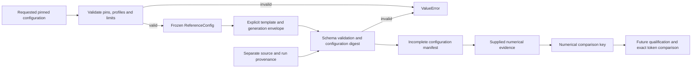

# Reference configuration and manifest contract

The reference configuration and schema validators run offline with Python's
standard library. They do not load a model, import inference libraries, probe
devices or qualify an environment. Model inference, golden token capture and
measurements are not implemented by these modules.

## Immutable intended configuration

`vortex.executor.reference_config.ReferenceConfig` is a frozen dataclass. Its
constructor and `validate_reference_config(config)` raise `ValueError` for
unsupported settings, without resolving aliases or changing the request.

Both the model and tokenizer use repository `Qwen/Qwen3-0.6B`, at commit
`c1899de289a04d12100db370d81485cdf75e47ca`. A different full SHA also requires a
reviewed contract change. Branches, tags, abbreviated SHAs and revision mismatch
are rejected.

| Profile identity | Intended device | Intended dtype | Attention |
| --- | --- | --- | --- |
| `windows-cpu` | `cpu` | `float32` | eager |
| `t4-fp16` | `cuda:0` | `float16` | eager |

These are intended profiles, not support claims. Exact environment resolution,
dependency compatibility, driver support and actual FP16 execution remain
NOT VERIFIED. No automatic device, dtype or backend selection is permitted.
BF16 and other devices require separately reviewed profiles.

The prompt limit counts tokens **after** chat templating. Integer limits are
inclusive: 1–512 prompt tokens and 1–64 newly emitted tokens, at most 576 total.
The default output cap is 32; EOS can finish earlier. Reject oversized prompts
instead of truncating them. Booleans and floating point values are not integer
token counts. This reference uses integer seed zero.

The future initial workload consists of these three independent user messages,
each with a nominal 32-token output cap:

- `Reply with the single word vortex.`
- `What is 2 + 2? Answer briefly.`
- `Explain a key-value cache in one short sentence.`

There is no system message or thinking suffix. `tokenize=True`,
`add_generation_prompt=True` and `enable_thinking=False` are required. The
template's empty thinking block belongs to the input identity. Eager attention,
no autocast/quantization/compilation, and a fresh model-owned `DynamicCache` per
request are the intended execution contract; actual enforcement in a loader or
generation call requires the later implementation.

## Schema 1

`validate_manifest(record: Mapping[str, object]) -> None` validates an owned JSON
snapshot, leaving the caller's mapping unchanged. It raises `ValueError` for
malformed types, missing or extra fields, unsupported settings, stale digests
and unsupported schema versions. Error messages identify the contract without
echoing supplied prompts, paths or values. There is no repair or coercion.

| Required top-level field | Meaning |
| --- | --- |
| `schema_version` | Integer `1`; incompatible schemas are rejected |
| `config` | All nine `ReferenceConfig` fields, including defaults |
| `chat_template` | The three explicit template flags described above |
| `generation` | The complete schema-1 generation envelope shown below |
| `config_sha256` | Digest of schema version, config, template and generation |
| `numerical` | Numerical input evidence object, or `null` in an initial draft |
| `comparison_key_sha256` | Numerical identity digest, or `null` without evidence |
| `provenance` | Source/run identity; required even for a draft |
| `outputs` | Consistent output object on success; otherwise `null` |
| `complete` | Boolean; a draft, failure or interruption must be `false` |
| `outcome` | `configured`, `failed`, `interrupted`, or completed `success` |

The generation envelope records explicit greedy settings and invocation controls.
It is **not** an object to pass directly as `generate(**envelope)`:
`use_model_defaults`, `forward_kwargs`, cache strategy and the absence of custom
processors are invocation metadata. Only the stated generation settings are
supported. The future adapter must create a fresh `GenerationConfig`, pass
`use_model_defaults=False`, supply a fresh `DynamicCache`, and record the full
effective library configuration when that adapter is implemented. In particular,
the pinned model's saved sampling defaults must never re-enable sampling.
Actual Transformers behavior and effective-config capture are NOT VERIFIED by
this offline schema check.

Both EOS IDs, `[151645, 151643]`, are required in that canonical order. Output IDs
include the terminal token. EOS wins when EOS and the output cap coincide, and
`reached_limit` remains true in that case. No string stops or thinking-tag stops
are supported. The schema validates these count/stop relationships on supplied
synthetic evidence; it does not verify that text is the decode of those IDs.

### Numerical input evidence

When present, `numerical` has exactly five objects:

- `assets`: `model_config_sha256`, `generation_config_sha256`,
  `tokenizer_config_sha256`, `chat_template_sha256`, `tokenizer_assets_sha256`
  and `weights_sha256`. The first four must match the pinned metadata hashes
  enforced by the validator. Each of the last two is a canonical digest of an
  external file inventory mapping relative asset filename to that file's SHA256.
  The tokenizer inventory covers every tokenizer/vocabulary/merges file used;
  the weights inventory covers every safetensors shard and its index if present.
  The validator checks hash shape, not file contents or inventory completeness.
- `prompt`: exactly one `messages` entry with `role=user` and nonblank `content`,
  `messages_sha256`, `rendered_prompt`, `rendered_sha256` and nonempty integer
  `input_ids`. The messages digest hashes `{"messages": messages}`. The rendered
  digest hashes exact UTF-8 text bytes. The validator checks both hashes and the
  post-template token count. Tokenizer equivalence and vocabulary membership
  need actual pinned assets and are NOT VERIFIED here.
- `environment`: `python_version`, `python_build`, `platform`, `machine`,
  `packages` and `hardware`. Use an exact Python 3.11 patch; retain complete
  interpreter/build and OS/glibc details in the build/platform strings.
  `packages` maps each installed distribution name to `version` and
  `wheel_sha256`, including the entire resolved transitive environment.
  The intended pins are Transformers `4.53.3` and torch `2.10.0+cpu` for CPU or
  `2.10.0+cu126` for CUDA. `hardware` contains `device`, `gpu_name`,
  `compute_capability` (two integers), `driver_version` and `cuda_runtime`.
  CPU GPU-specific fields are all null. Structural validation cannot establish
  whether a supplied package inventory is complete or an environment works.
- `determinism`: `seed=0`, `pythonhashseed="0"`,
  `cublas_workspace_config=":4096:8"`, `cudnn_benchmark=false`,
  `allow_tf32_matmul=false`, `allow_tf32_cudnn=false` and
  `deterministic_algorithms=true`. These record requested settings; setting them
  early enough and observing their effects requires a later execution check.
- `effective_generation_config`: the full serialized library generation
  configuration, including its `transformers_version`. All explicit generation
  settings from the envelope must also appear here with the same typed values.
  Invocation metadata is kept in the envelope. Additional library fields are
  retained as bounded JSON evidence and participate in numerical identity; they
  are never applied as configuration overrides by this validator. Capturing the
  actual full export and checking additional version-specific fields against
  intended execution belong to the later adapter qualification.

`outputs` on success contains `prompt_ids`, `sequence_ids`, `generated_ids`,
`raw_text`, `display_text`, `stop_reason` and `reached_limit`. The validator
requires prompt/output concatenation, bounded new tokens, and consistent EOS or
limit completion. It never derives outputs from a prompt or invents goldens.
`complete=true` means internally consistent supplied evidence, not independently
qualified inference. A configuration-only record cannot claim completion.

### Provenance and compatibility

`provenance` contains a full lowercase `source_sha`, boolean `dirty`,
`patch_sha256` (required for dirty source, otherwise null), `adapter_version`,
canonical UUID `run_id` and `session_id`, and a UTC ISO8601 `timestamp` ending in
`Z`. Run/session identifiers are random identifiers, not account names or paths.

Configuration identity is:

```text
config_sha256 = canonical_digest({schema_version, config, chat_template, generation})
```

Numerical compatibility identity is:

```text
comparison_key_sha256 = canonical_digest({config_sha256, numerical})
```

Provenance and outputs are excluded from both digests. A new run, timestamp,
source commit or patch can retain the same numerical key. Source/adapter changes
still require review and requalification; equal keys cannot establish that an
implementation used the declared settings. Different input IDs, asset hashes,
software/build/hardware evidence or numerical settings change the comparison
key. Matching keys permit a later exact token comparison; they do not prove
equal outputs. Different profiles are incompatible for exact parity.

`canonical_digest` hashes compact key-sorted JSON in UTF-8 without a BOM or
trailing newline. Array order and Unicode codepoints are preserved; no Unicode
normalization occurs. Finite JSON numbers retain their Python JSON representation
(`1` differs from `1.0`). Non-string object keys, tuples, sets, non-finite numbers,
lone surrogates, cycles, more than 32 nesting levels and payloads above 1 MiB
are rejected. Snapshot work is also bounded before serialization. This is a
Python JSON encoding contract, not an assertion of RFC 8785 compliance.

The public API consumes mappings. A JSON decoder must reject duplicate keys
before producing that mapping: duplicates lost by a permissive decoder cannot
be detected afterward. Non-JSON file parsing and I/O belong at the caller's
boundary. Schema changes that alter accepted meanings or identity encoding
require a reviewed version change; schema 1 never silently upgrades a record.

## Runnable configuration-only example

From the repository root, run this with Python 3.11+. Provenance below is
explicitly synthetic. No model assets, environment evidence or outputs are
asserted, and the record remains incomplete. All generation values are explicit.

```python
from dataclasses import asdict
import sys

sys.path.insert(0, "src")
from vortex.executor.reference_config import ReferenceConfig
from vortex.executor.reference_manifest import canonical_digest, validate_manifest

pin = "c1899de289a04d12100db370d81485cdf75e47ca"
config = ReferenceConfig("Qwen/Qwen3-0.6B", pin, pin, "windows-cpu", "cpu", "float32")
manifest = {
    "schema_version": 1,
    "config": asdict(config),
    "chat_template": {
        "tokenize": True, "add_generation_prompt": True, "enable_thinking": False,
    },
    "generation": {
        "do_sample": False, "num_beams": 1, "num_beam_groups": 1,
        "num_return_sequences": 1, "max_new_tokens": 32, "min_new_tokens": 0,
        "use_cache": True, "eos_token_id": [151645, 151643],
        "pad_token_id": 151643, "bos_token_id": 151643,
        "repetition_penalty": 1.0, "no_repeat_ngram_size": 0, "length_penalty": 1.0,
        "return_dict_in_generate": True, "output_scores": False, "output_logits": False,
        "output_attentions": False, "output_hidden_states": False,
        "temperature": 1.0, "top_p": 1.0, "top_k": 50,
        "use_model_defaults": False, "forward_kwargs": {"logits_to_keep": 1},
        "cache_strategy": "fresh_dynamic", "custom_logits_processors": [],
        "custom_stopping_criteria": [], "streamer": None, "assistant_model": None,
        "custom_generate": None, "max_time": None,
    },
}
manifest["config_sha256"] = canonical_digest(manifest)
manifest.update(
    numerical=None, comparison_key_sha256=None, outputs=None,
    complete=False, outcome="configured",
    provenance={
        "source_sha": "0" * 40, "dirty": False, "patch_sha256": None,
        "adapter_version": "example-schema-v1",
        "run_id": "00000000-0000-4000-8000-000000000001",
        "session_id": "00000000-0000-4000-8000-000000000002",
        "timestamp": "2026-10-29T12:00:00Z",
    },
)
validate_manifest(manifest)
print(manifest["config_sha256"])
```

## Verification and change boundary

```sh
python -m unittest discover -s tests/unit -p "test_reference_*.py" -v
python scripts/verify.py
```

Tests use synthetic records, including synthetic IDs and environment hashes.
They establish offline validation and identity behavior, not pretrained
correctness, environment compatibility, device behavior or performance.
The actual greedy call must separately prove saved model defaults cannot enable
sampling. Golden acceptance requires reviewed same-fingerprint repeats and a
fresh-process replay; that comparison and qualification are future work.

Keep real run records, raw token evidence, file inventories and environment
qualification evidence outside the public checkout. Review exact working files
against the publication policy before staging. Obtain the required approval for
the exact file list and commit message before staging or committing. The existing
staged publication check does not inspect unstaged proposals.


