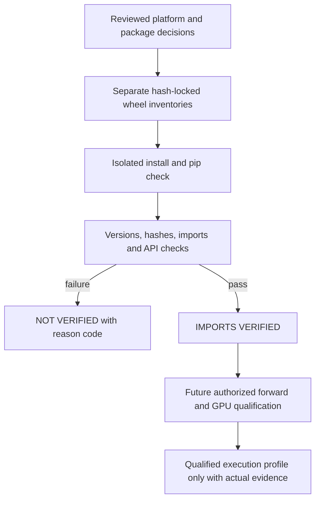

# Reference dependency profiles and qualification

These profiles prepare an external reference experiment. The base Vortex package
still has no mandatory inference dependencies. Installation, imports, API
inspection, model execution and numerical qualification are separate gates.

| Profile | Interpreter | Torch | Transformers | Intended execution |
| --- | --- | --- | --- | --- |
| `windows-cpu` | CPython 3.11.18, Windows AMD64 | `2.10.0+cpu` | `4.53.3` | CPU/FP32 diagnostic |
| `t4-fp16` | CPython 3.11.18, Linux x86_64, glibc >=2.28 | `2.10.0+cu126` | `4.53.3` | One selected T4, FP16/eager |

The Linux profile needs CUDA runtime metadata `12.6`, a compiled `sm_75` target,
compute capability 7.5 and a compatible NVIDIA driver. The conservative
compatibility floor is Linux driver 560.35.05 for CUDA 12.6 Update 3. This is
not a current driver-security qualification: review the actual driver branch
against current NVIDIA security bulletins before use. A system CUDA toolkit or
nvcc is not needed for the prebuilt wheels. No CPU fallback, automatic precision
change or alternate attention backend is permitted.

The selected interpreter patch is a new explicit lock decision. Python 3.11.5
can run offline tooling, but is not the reference environment. Python 3.11.18
fixes the SSL-layer compromised-CA issue and other security defects described
in the [PSF release](https://www.python.org/downloads/release/python-31118/).
Python.org no longer publishes Windows installers for this security-only line.
The isolated candidate uses the independently distributed Astral
[20261026 build](https://github.com/astral-sh/python-build-standalone/releases/tag/20261026),
not a purported python.org installer. Record its archive hash, executable hash,
full interpreter version/build and OS in private qualification evidence.

The selected `install_only_stripped.tar.gz` archive identities from that immutable
release are:

| Target | SHA256 |
| --- | --- |
| `cpython-3.11.18+20261026-x86_64-pc-windows-msvc` | `67215a7bf1643e33d01b17ee3f1e91a8b0b39163746855ee02594bf0608f68b4` |
| `cpython-3.11.18+20261026-x86_64-unknown-linux-gnu` | `17c4978a36c496dc53c08899ef8dad1ad2734f6325f08d6033a1e66419e0af26` |

The pinned download-metadata snapshot in the setup command supplies these hashes
to uv. Verify the archive identity before accepting a replacement or mirror.

## Lock format and sources

The two machine-readable JSON fences below are complete target-active wheel
inventories. Every entry has one exact version, official wheel URL, SHA256 and
active dependency names. The qualification utility validates the graph, rejects
missing/orphan/duplicate packages and emits a pip requirements file with
`--no-index`, `--only-binary=:all:` and `--require-hashes`. Direct URLs bind each
package to one reviewed source; no unrestricted extra index or source build is
used. Do not edit generated requirements to make a failed install succeed.

Torch comes from the official CPU or CUDA 12.6 index. Other wheels come from
PyPI's `files.pythonhosted.org`. The index currently serves Torch artifacts from
`download-r2.pytorch.org`; that official link target is recorded explicitly.
The exact artifact URLs and hashes, rather than a moving index response, define
the install. An optional package extra alone is not a reproducible lock or an
instruction to let PyPI choose a Torch build.

Resolution used uv 0.10.7 with explicit CPython 3.11 target/platform markers,
binary-only packages, PyPI as the default index and a direct official Torch
wheel. Windows and Linux were resolved separately. Target-active dependency
constraints were checked again from published metadata. Pip's `--platform`
option alone is insufficient to establish the Linux marker environment from
Windows. Metadata resolution is not a native installation or GPU qualification.

Significant dependencies:

- Torch supplies tensors, CUDA metadata and the future execution backend.
- Transformers supplies native Qwen3, GenerationConfig and DynamicCache APIs.
- Tokenizers and Hugging Face Hub are required by Transformers; their compatible
  lines are Tokenizers `>=0.21,<0.22` and Hub `>=0.30,<1.0`.
- Safetensors supplies the intended future weight format. NumPy, packaging,
  regex, PyYAML, tqdm and HTTP/cache dependencies are required transitively.
- Jinja2/MarkupSafe, SymPy/mpmath, NetworkX, fsspec and typing extensions are
  Torch dependencies. The GPU lock additionally includes Torch's required CUDA
  libraries, CUDA bindings and Triton; they are absent from the CPU lock.
- Pip is pinned as an environment verification/install tool so `pip check` can
  be reproduced. It is not a runtime dependency of the base Vortex package.

No Accelerate, PEFT, optional kernels package, FlashAttention, bitsandbytes,
torchvision, torchaudio, TensorFlow, Flax or serving framework is needed.

## Reproducible setup

Choose all destinations outside the public checkout. The following paths are
examples of operator-controlled private locations. The utility refuses to
overwrite an existing requirements file or write it inside the checkout.

Windows, with uv 0.10.7 and the pinned Astral metadata snapshot:

```powershell
uv python install 3.11.18 --python-downloads-json-url https://raw.githubusercontent.com/astral-sh/uv/0.13.6/crates/uv-python-managed/download-metadata.json --install-dir D:/vortex-environments/python --no-bin --no-registry
uv venv --no-project --python D:/vortex-environments/python/cpython-3.11.18-windows-x86_64-none/python.exe D:/vortex-environments/windows-cpu
python scripts/verify_reference_environment.py --profile windows-cpu --emit-requirements D:/vortex-environments/windows-cpu-requirements.txt
python scripts/verify_reference_environment.py --profile windows-cpu --bootstrap-only --emit-requirements D:/vortex-environments/pip-bootstrap.txt
uv pip install --python D:/vortex-environments/windows-cpu/Scripts/python.exe --no-deps --require-hashes -r D:/vortex-environments/pip-bootstrap.txt
D:/vortex-environments/windows-cpu/Scripts/python.exe -I -m pip install --force-reinstall --no-input --require-hashes -r D:/vortex-environments/windows-cpu-requirements.txt
D:/vortex-environments/windows-cpu/Scripts/python.exe -m pip check
D:/vortex-environments/windows-cpu/Scripts/python.exe scripts/verify_reference_environment.py --profile windows-cpu
```

The initial `python` invocation only extracts a static lock with standard-library
code. Use the locked interpreter for imports and integration checks. The managed
interpreter is installed without replacing PATH entries or Windows registry
registration. The distribution source is a reproducibility/trust decision; a
different interpreter build gets different numerical evidence even at the same
patch version.

On an authorized Linux GPU host, first install/verify the exact locked Python
build and uv 0.10.7. Create an unseeded environment and sync the exact inventory;
the Python 3.11 standard venv seeds setuptools, which is outside these locks.

```sh
uv venv --no-project --python python3.11 /private/vortex/t4-fp16
python3.11 scripts/verify_reference_environment.py --profile t4-fp16 --emit-requirements /private/vortex/t4-fp16-requirements.txt
python3.11 scripts/verify_reference_environment.py --profile t4-fp16 --bootstrap-only --emit-requirements /private/vortex/pip-bootstrap.txt
uv pip install --python /private/vortex/t4-fp16/bin/python --no-deps --require-hashes -r /private/vortex/pip-bootstrap.txt
/private/vortex/t4-fp16/bin/python -I -m pip install --force-reinstall --no-input --require-hashes -r /private/vortex/t4-fp16-requirements.txt
/private/vortex/t4-fp16/bin/python -m pip check
/private/vortex/t4-fp16/bin/python scripts/verify_reference_environment.py --profile t4-fp16
```

The verifier checks exact patch, platform, wheel-origin hashes recorded by the
installer, package versions, pip consistency and required APIs. It reuses the
existing capability probe. Heavy imports run in a quiet bounded child process;
native diagnostics are suppressed and public failures contain bounded reason
codes with remediation. Missing dependencies, wrong interpreter, import errors
and timeouts do not become a successful profile.

The two installer steps are intentional. uv 0.10.7 can enforce installation
hashes while writing empty PEP 610 archive-hash fields. It bootstraps only the
locked pip wheel here. Pip then installs the complete lock, including itself,
and records verifiable archive hashes. The verifier refuses missing or stale
hash receipts before importing native libraries; it never fills them from the
expected lock to make an environment appear verified.

Close running Python processes or restart the notebook kernel after installation
before checking the profile. An already imported library can retain a different
build in memory; the verifier uses a fresh isolated worker for this reason.

Tests:

```sh
python -m unittest discover -s tests/unit -p "test_reference_environment.py" -v
python scripts/verify.py
```

Opt in to the installed-environment test with `VORTEX_REFERENCE_ENVIRONMENT=1`
and `VORTEX_REFERENCE_PROFILE=windows-cpu` (or `t4-fp16`) and run:

```sh
python -m unittest discover -s tests/integration -p "test_reference_environment.py" -v
```

The integration test uses the interpreter that launched it. It imports libraries,
inspects signatures and an empty cache, and calls neither forward nor generate.
No pretrained weights, tensors, model construction or downloads are involved.

## Qualification status and security limits

`IMPORTS_VERIFIED` means only the exact installed metadata/import/API gates
passed. The verifier always reports `qualified=false` and
`forward_smoke=NOT_VERIFIED`: no model execution has been authorized here.
Actual small-model forward/cache-growth smoke, native FP16, GPU driver/device
qualification and pretrained correctness remain separate gates. Skipped tests
or successful resolution cannot satisfy them.

Observed on 30 October 2026: the isolated Windows CPython 3.11.18 environment
installed all 25 locked wheels, passed `pip check`, and returned
`IMPORTS_VERIFIED`. The opt-in integration test passed. Torch reported
`2.10.0+cpu`, no CUDA runtime and zero CUDA devices; Transformers reported
`4.53.3`. The interpreter build was `main, Oct 26 2026 14:08:50`, with Torch
source build `449b1768410104d3ed79d3bcfe4ba1d65c7f22c0`. Installed versions,
origins and archive-hash receipts matched the complete lock before imports.

Linux has a resolved 43-wheel inventory and reviewed target metadata only.
Native Linux installation/imports, CUDA metadata from that installed build,
the actual driver and T4, FP16 forward and cache growth are **NOT VERIFIED**.
Windows forward/cache growth is also **NOT VERIFIED**. Neither execution
profile is fully qualified.

Current advisory review supports only the restricted native-Qwen/eager path.
Historical pins are not vulnerability-free. In particular:

- Transformers' [kernel-loading trust bypass](https://github.com/advisories/GHSA-29pf-2h5f-8g72)
  requires verifying that optional `kernels` is absent and future model config
  is the reviewed pinned file. Eager alone does not neutralize malicious private
  attention implementation fields. Reject those fields before future loading.
- Exclude custom generation, Trainer/checkpoint resume, TorchScript/compilation,
  `torch.export.load`, Hub checkpoint helpers and tokenizer `save_pretrained`.
  Safetensors alone does not make arbitrary shard-index filenames safe.
- Hub 0.36.2 predates the maintainer's
  [local-directory path hardening](https://github.com/huggingface/huggingface_hub/releases/tag/v1.26.0).
  Future acquisition requires fixed reviewed filenames, pinned revision and a
  private cache; do not accept arbitrary remote paths or broad local-directory
  snapshots. A patch or acquisition-stack change requires review because this
  Transformers line requires Hub below 1.0.
- The selected Filelock, urllib3, Requests, certifi and Jinja2 pins incorporate
  fixes identified during dependency review. That is not a complete native
  binary or future-advisory audit. Use a private cache with restrictive access.

If installation fails, check the exact Python architecture/patch, official wheel
origin, TLS and available disk. Do not add random indexes, disable certificate
checking, build an unreviewed source distribution or substitute a CUDA build.
For native DLL errors, verify Windows runtime prerequisites in the isolated
environment. A missing compatible GPU means defer, never switch to CPU silently.



## Windows CPU hash lock

The fence below is consumed directly by the qualification utility.

<!-- vortex-lock:windows-cpu -->
```json
{
  "schema_version": 1,
  "profile_id": "windows-cpu",
  "python_version": "3.11.18",
  "implementation": "CPython",
  "system": "Windows",
  "machine": "AMD64",
  "index_url": "https://pypi.org/simple",
  "torch_index_url": "https://download.pytorch.org/whl/cpu",
  "roots": [
    "pip",
    "torch",
    "transformers"
  ],
  "packages": [
    {
      "name": "certifi",
      "version": "2026.10.23",
      "url": "https://files.pythonhosted.org/packages/32/d1/a3652fe2c19134d0d15922177821d863cbd7e842d53a21bbe7e8e3a1b5ac/certifi-2026.10.23-py3-none-any.whl",
      "sha256": "e9b54de76e530bb6cf0ccd036787103acb58fd42ba930ea8bf948ddbaa2f61d1",
      "requires": []
    },
    {
      "name": "charset-normalizer",
      "version": "3.5.2",
      "url": "https://files.pythonhosted.org/packages/e8/fc/fdf8cf52ff21cd5bf158f20978991cf985325842f74283eb6df26c8a39d8/charset_normalizer-3.5.2-cp311-cp311-win_amd64.whl",
      "sha256": "87e50a3e7cb90af586b6c5faf23e302a970415ac73bd7bd90a515a04b427ef96",
      "requires": []
    },
    {
      "name": "colorama",
      "version": "0.4.6",
      "url": "https://files.pythonhosted.org/packages/d1/d6/3965ed04c63042e047cb6a3e6ed1a63a35087b6a609aa3a15ed8ac56c221/colorama-0.4.6-py2.py3-none-any.whl",
      "sha256": "4f1d9991f5acc0ca119f9d443620b77f9d6b33703e51011c16baf57afb285fc6",
      "requires": []
    },
    {
      "name": "filelock",
      "version": "4.2.4",
      "url": "https://files.pythonhosted.org/packages/e0/1b/5e74289a1878e666bb4b65fe5805a04cafcac2aa5f519ef1ead67ef91c56/filelock-4.2.4-py3-none-any.whl",
      "sha256": "301241438c57936ef93f4243a94f2559022268bfcf9b375a9a72eb0f8db8358e",
      "requires": []
    },
    {
      "name": "fsspec",
      "version": "2026.9.0",
      "url": "https://files.pythonhosted.org/packages/6c/c0/a98505f18594f1bce828bb159cec0fcf9860562f1a2c85913409fc8f3d9e/fsspec-2026.9.0-py3-none-any.whl",
      "sha256": "8dd6e646e99ea382bd85f97a45e6b526a442d79423a7dc673f1e2756d05fcb5f",
      "requires": []
    },
    {
      "name": "huggingface-hub",
      "version": "0.36.2",
      "url": "https://files.pythonhosted.org/packages/a8/af/48ac8483240de756d2438c380746e7130d1c6f75802ef22f3c6d49982787/huggingface_hub-0.36.2-py3-none-any.whl",
      "sha256": "48f0c8eac16145dfce371e9d2d7772854a4f591bcb56c9cf548accf531d54270",
      "requires": [
        "filelock",
        "fsspec",
        "packaging",
        "pyyaml",
        "requests",
        "tqdm",
        "typing-extensions"
      ]
    },
    {
      "name": "idna",
      "version": "3.20",
      "url": "https://files.pythonhosted.org/packages/58/a2/bb081bab032533a855d44de1d56f8e8426114ff1ba5d1f07a438a0a654f8/idna-3.20-py3-none-any.whl",
      "sha256": "ab7ae7122974553370f0bdb919e1a960b2cd1bc1ef0276416d896db81c14582c",
      "requires": []
    },
    {
      "name": "jinja2",
      "version": "3.1.6",
      "url": "https://files.pythonhosted.org/packages/62/a1/3d680cbfd5f4b8f15abc1d571870c5fc3e594bb582bc3b64ea099db13e56/jinja2-3.1.6-py3-none-any.whl",
      "sha256": "85ece4451f492d0c13c5dd7c13a64681a86afae63a5f347908daf103ce6d2f67",
      "requires": [
        "markupsafe"
      ]
    },
    {
      "name": "markupsafe",
      "version": "3.0.4",
      "url": "https://files.pythonhosted.org/packages/91/89/f2b509f7bf79352e40117824c1070dbeafd4df67031d3fa98165a3134228/markupsafe-3.0.4-cp311-cp311-win_amd64.whl",
      "sha256": "fdb4ca07ab75ffadab4a8b135ad59cdbb3156b99310f3d565370da74a15d6bd3",
      "requires": []
    },
    {
      "name": "mpmath",
      "version": "1.3.0",
      "url": "https://files.pythonhosted.org/packages/43/e3/7d92a15f894aa0c9c4b49b8ee9ac9850d6e63b03c9c32c0367a13ae62209/mpmath-1.3.0-py3-none-any.whl",
      "sha256": "a0b2b9fe80bbcd81a6647ff13108738cfb482d481d826cc0e02f5b35e5c88d2c",
      "requires": []
    },
    {
      "name": "networkx",
      "version": "3.6.1",
      "url": "https://files.pythonhosted.org/packages/9e/c9/b2622292ea83fbb4ec318f5b9ab867d0a28ab43c5717bb85b0a5f6b3b0a4/networkx-3.6.1-py3-none-any.whl",
      "sha256": "d47fbf302e7d9cbbb9e2555a0d267983d2aa476bac30e90dfbe5669bd57f3762",
      "requires": []
    },
    {
      "name": "numpy",
      "version": "2.4.6",
      "url": "https://files.pythonhosted.org/packages/c5/31/7fc6239c12bce7e931463251cca4426c465e1876ba3cc785402ef4dd8f4e/numpy-2.4.6-cp311-cp311-win_amd64.whl",
      "sha256": "1e254a00cdf42b1e4d5b3d68d33af63268d41340d8885df2ab6470f2e1500147",
      "requires": []
    },
    {
      "name": "packaging",
      "version": "26.3",
      "url": "https://files.pythonhosted.org/packages/63/34/ba1c580383c9eada3711951fef0795c80b829a078d72188184bcab9dd527/packaging-26.3-py3-none-any.whl",
      "sha256": "d7193f7c8e4e93f444fde0262bf90af30e16fa0ad0ad44cb553c87339b23cd1c",
      "requires": []
    },
    {
      "name": "pip",
      "version": "26.2.2",
      "url": "https://files.pythonhosted.org/packages/3f/06/3e4420302363fbb71be3c7f35ce042f54bfca330e3e66b3a2e3c4cca579f/pip-26.2.2-py3-none-any.whl",
      "sha256": "fd7f4dfa8190e014013b9f08f3e973f4e4c26ffd179a204895533a7254813a70",
      "requires": []
    },
    {
      "name": "pyyaml",
      "version": "6.0.3",
      "url": "https://files.pythonhosted.org/packages/da/e3/ea007450a105ae919a72393cb06f122f288ef60bba2dc64b26e2646fa315/pyyaml-6.0.3-cp311-cp311-win_amd64.whl",
      "sha256": "9f3bfb4965eb874431221a3ff3fdcddc7e74e3b07799e0e84ca4a0f867d449bf",
      "requires": []
    },
    {
      "name": "regex",
      "version": "2026.9.29",
      "url": "https://files.pythonhosted.org/packages/4d/4a/aab232183c70fdcf77bcf0c51819da02ec522e393e6a0bf00bcf2142e21f/regex-2026.9.29-cp311-cp311-win_amd64.whl",
      "sha256": "1043aedf5917caa861bcb25a9c11460049656bdf0017a90a309fa8f255467725",
      "requires": []
    },
    {
      "name": "requests",
      "version": "2.34.2",
      "url": "https://files.pythonhosted.org/packages/a0/f4/c67b0b3f1b9245e8d266f0f112c500d50e5b4e83cb6f3b71b6528104182a/requests-2.34.2-py3-none-any.whl",
      "sha256": "2a0d60c172f83ac6ab31e4554906c0f3b3588d37b5cb939b1c061f4907e278e0",
      "requires": [
        "certifi",
        "charset-normalizer",
        "idna",
        "urllib3"
      ]
    },
    {
      "name": "safetensors",
      "version": "0.8.0",
      "url": "https://files.pythonhosted.org/packages/1b/6d/3fba214c1e5e0f69991677ec3bc17023f0421776975e1de0c682dca475e2/safetensors-0.8.0-cp310-abi3-win_amd64.whl",
      "sha256": "096ec1a98435df7beb08853bb5aa9081a84f23d0adc67ed1a0a10550f608373f",
      "requires": []
    },
    {
      "name": "sympy",
      "version": "1.14.0",
      "url": "https://files.pythonhosted.org/packages/a2/09/77d55d46fd61b4a135c444fc97158ef34a095e5681d0a6c10b75bf356191/sympy-1.14.0-py3-none-any.whl",
      "sha256": "e091cc3e99d2141a0ba2847328f5479b05d94a6635cb96148ccb3f34671bd8f5",
      "requires": [
        "mpmath"
      ]
    },
    {
      "name": "tokenizers",
      "version": "0.21.4",
      "url": "https://files.pythonhosted.org/packages/41/f2/fd673d979185f5dcbac4be7d09461cbb99751554ffb6718d0013af8604cb/tokenizers-0.21.4-cp39-abi3-win_amd64.whl",
      "sha256": "475d807a5c3eb72c59ad9b5fcdb254f6e17f53dfcbb9903233b0dfa9c943b597",
      "requires": [
        "huggingface-hub"
      ]
    },
    {
      "name": "torch",
      "version": "2.10.0+cpu",
      "url": "https://download-r2.pytorch.org/whl/cpu/torch-2.10.0%2Bcpu-cp311-cp311-win_amd64.whl",
      "sha256": "17a09465bab2aab8f0f273410297133d8d8fb6dd84dccbd252ca4a4f3a111847",
      "requires": [
        "filelock",
        "fsspec",
        "jinja2",
        "networkx",
        "sympy",
        "typing-extensions"
      ]
    },
    {
      "name": "tqdm",
      "version": "4.70.1",
      "url": "https://files.pythonhosted.org/packages/a7/03/921a3d3c75785aca9ebfbfcabfbc3a1be12e2ab5265deb026d55a5a3f83e/tqdm-4.70.1-py3-none-any.whl",
      "sha256": "c293e525e6fef9c20e8728fd4612df02a0aa31bb5fe91ecd93e123b1b7bffa73",
      "requires": [
        "colorama"
      ]
    },
    {
      "name": "transformers",
      "version": "4.53.3",
      "url": "https://files.pythonhosted.org/packages/41/b1/d7520cc5cb69c825599042eb3a7c986fa9baa8a8d2dea9acd78e152c81e2/transformers-4.53.3-py3-none-any.whl",
      "sha256": "5aba81c92095806b6baf12df35d756cf23b66c356975fb2a7fa9e536138d7c75",
      "requires": [
        "filelock",
        "huggingface-hub",
        "numpy",
        "packaging",
        "pyyaml",
        "regex",
        "requests",
        "safetensors",
        "tokenizers",
        "tqdm"
      ]
    },
    {
      "name": "typing-extensions",
      "version": "4.16.0",
      "url": "https://files.pythonhosted.org/packages/49/d3/b8441a820a491ddfc024b0b0cf0393375b75ea13866d9c66727e54c2fc80/typing_extensions-4.16.0-py3-none-any.whl",
      "sha256": "481caa481374e813c1b176ada14e97f1f67a4539ce9cfeb3f350d78d6370c2e8",
      "requires": []
    },
    {
      "name": "urllib3",
      "version": "2.8.0",
      "url": "https://files.pythonhosted.org/packages/92/9d/c4e665119135114480843e7ab388fa94d8480650450e6f8e26b70d323a4c/urllib3-2.8.0-py3-none-any.whl",
      "sha256": "0cf3cae568d36aa9576b28dfb35f11328f1cb974ca7647d9475ebb86c75ac6e3",
      "requires": []
    }
  ]
}
```

## Linux CUDA hash lock

This is a resolved artifact inventory, not a Linux installation or GPU result.

<!-- vortex-lock:t4-fp16 -->
```json
{
  "schema_version": 1,
  "profile_id": "t4-fp16",
  "python_version": "3.11.18",
  "implementation": "CPython",
  "system": "Linux",
  "machine": "x86_64",
  "index_url": "https://pypi.org/simple",
  "torch_index_url": "https://download.pytorch.org/whl/cu126",
  "roots": [
    "pip",
    "torch",
    "transformers"
  ],
  "packages": [
    {
      "name": "certifi",
      "version": "2026.10.23",
      "url": "https://files.pythonhosted.org/packages/32/d1/a3652fe2c19134d0d15922177821d863cbd7e842d53a21bbe7e8e3a1b5ac/certifi-2026.10.23-py3-none-any.whl",
      "sha256": "e9b54de76e530bb6cf0ccd036787103acb58fd42ba930ea8bf948ddbaa2f61d1",
      "requires": []
    },
    {
      "name": "charset-normalizer",
      "version": "3.5.2",
      "url": "https://files.pythonhosted.org/packages/e4/ed/cf505d3011ffceb12c2067a7a5d3cfe92b875d4d44bb0ff0d69375e2c184/charset_normalizer-3.5.2-cp311-cp311-manylinux2014_x86_64.manylinux_2_17_x86_64.manylinux_2_28_x86_64.whl",
      "sha256": "211d5a3eb6af8f513b8d4ca19a8c1b7accab1b5f0d3175f9826b03c1a920dc1f",
      "requires": []
    },
    {
      "name": "cuda-bindings",
      "version": "12.9.4",
      "url": "https://files.pythonhosted.org/packages/45/e7/b47792cc2d01c7e1d37c32402182524774dadd2d26339bd224e0e913832e/cuda_bindings-12.9.4-cp311-cp311-manylinux_2_24_x86_64.manylinux_2_28_x86_64.whl",
      "sha256": "c912a3d9e6b6651853eed8eed96d6800d69c08e94052c292fec3f282c5a817c9",
      "requires": [
        "cuda-pathfinder"
      ]
    },
    {
      "name": "cuda-pathfinder",
      "version": "1.8.4",
      "url": "https://files.pythonhosted.org/packages/8e/93/f0904fa7d954ecc4c0db17c8d63d185d442dd59fc6757f1d1f448c59c256/cuda_pathfinder-1.8.4-py3-none-any.whl",
      "sha256": "85a4e708c725d603f576042ef32781a3d1737c51e84c35fe361d2680191af65a",
      "requires": []
    },
    {
      "name": "filelock",
      "version": "4.2.4",
      "url": "https://files.pythonhosted.org/packages/e0/1b/5e74289a1878e666bb4b65fe5805a04cafcac2aa5f519ef1ead67ef91c56/filelock-4.2.4-py3-none-any.whl",
      "sha256": "301241438c57936ef93f4243a94f2559022268bfcf9b375a9a72eb0f8db8358e",
      "requires": []
    },
    {
      "name": "fsspec",
      "version": "2026.9.0",
      "url": "https://files.pythonhosted.org/packages/6c/c0/a98505f18594f1bce828bb159cec0fcf9860562f1a2c85913409fc8f3d9e/fsspec-2026.9.0-py3-none-any.whl",
      "sha256": "8dd6e646e99ea382bd85f97a45e6b526a442d79423a7dc673f1e2756d05fcb5f",
      "requires": []
    },
    {
      "name": "hf-xet",
      "version": "1.7.1",
      "url": "https://files.pythonhosted.org/packages/91/99/105c23da56161acdc4e5b3022ae6d225ab54269a44eb7303f41e3a7be09e/hf_xet-1.7.1-cp38-abi3-manylinux2014_x86_64.manylinux_2_17_x86_64.whl",
      "sha256": "f26bfd4a6e31b4e37e749a07e8642589406e8537be05eccfd633a92b95e2fb51",
      "requires": []
    },
    {
      "name": "huggingface-hub",
      "version": "0.36.2",
      "url": "https://files.pythonhosted.org/packages/a8/af/48ac8483240de756d2438c380746e7130d1c6f75802ef22f3c6d49982787/huggingface_hub-0.36.2-py3-none-any.whl",
      "sha256": "48f0c8eac16145dfce371e9d2d7772854a4f591bcb56c9cf548accf531d54270",
      "requires": [
        "filelock",
        "fsspec",
        "hf-xet",
        "packaging",
        "pyyaml",
        "requests",
        "tqdm",
        "typing-extensions"
      ]
    },
    {
      "name": "idna",
      "version": "3.20",
      "url": "https://files.pythonhosted.org/packages/58/a2/bb081bab032533a855d44de1d56f8e8426114ff1ba5d1f07a438a0a654f8/idna-3.20-py3-none-any.whl",
      "sha256": "ab7ae7122974553370f0bdb919e1a960b2cd1bc1ef0276416d896db81c14582c",
      "requires": []
    },
    {
      "name": "jinja2",
      "version": "3.1.6",
      "url": "https://files.pythonhosted.org/packages/62/a1/3d680cbfd5f4b8f15abc1d571870c5fc3e594bb582bc3b64ea099db13e56/jinja2-3.1.6-py3-none-any.whl",
      "sha256": "85ece4451f492d0c13c5dd7c13a64681a86afae63a5f347908daf103ce6d2f67",
      "requires": [
        "markupsafe"
      ]
    },
    {
      "name": "markupsafe",
      "version": "3.0.4",
      "url": "https://files.pythonhosted.org/packages/81/a5/a513b76c139a3915b43404324e55c0b7979ae4f0d39eb6f075b0282e90a8/markupsafe-3.0.4-cp311-cp311-manylinux2014_x86_64.manylinux_2_17_x86_64.manylinux_2_28_x86_64.whl",
      "sha256": "6da83a088f8ef93b2d483a8232a4dbf4d69d3d8496b568a03c56becac43e1808",
      "requires": []
    },
    {
      "name": "mpmath",
      "version": "1.3.0",
      "url": "https://files.pythonhosted.org/packages/43/e3/7d92a15f894aa0c9c4b49b8ee9ac9850d6e63b03c9c32c0367a13ae62209/mpmath-1.3.0-py3-none-any.whl",
      "sha256": "a0b2b9fe80bbcd81a6647ff13108738cfb482d481d826cc0e02f5b35e5c88d2c",
      "requires": []
    },
    {
      "name": "networkx",
      "version": "3.6.1",
      "url": "https://files.pythonhosted.org/packages/9e/c9/b2622292ea83fbb4ec318f5b9ab867d0a28ab43c5717bb85b0a5f6b3b0a4/networkx-3.6.1-py3-none-any.whl",
      "sha256": "d47fbf302e7d9cbbb9e2555a0d267983d2aa476bac30e90dfbe5669bd57f3762",
      "requires": []
    },
    {
      "name": "numpy",
      "version": "2.4.6",
      "url": "https://files.pythonhosted.org/packages/02/03/74fe2a4cb3817d94d86402f2506554130a2f01414e299b5a843e5a8a957f/numpy-2.4.6-cp311-cp311-manylinux_2_27_x86_64.manylinux_2_28_x86_64.whl",
      "sha256": "89cd468399cfd2504718f0ba50e410dca55a170b61a02ad92bb18c8a65186e93",
      "requires": []
    },
    {
      "name": "nvidia-cublas-cu12",
      "version": "12.6.4.1",
      "url": "https://files.pythonhosted.org/packages/af/eb/ff4b8c503fa1f1796679dce648854d58751982426e4e4b37d6fce49d259c/nvidia_cublas_cu12-12.6.4.1-py3-none-manylinux2014_x86_64.manylinux_2_17_x86_64.whl",
      "sha256": "08ed2686e9875d01b58e3cb379c6896df8e76c75e0d4a7f7dace3d7b6d9ef8eb",
      "requires": []
    },
    {
      "name": "nvidia-cuda-cupti-cu12",
      "version": "12.6.80",
      "url": "https://files.pythonhosted.org/packages/49/60/7b6497946d74bcf1de852a21824d63baad12cd417db4195fc1bfe59db953/nvidia_cuda_cupti_cu12-12.6.80-py3-none-manylinux2014_x86_64.manylinux_2_17_x86_64.whl",
      "sha256": "6768bad6cab4f19e8292125e5f1ac8aa7d1718704012a0e3272a6f61c4bce132",
      "requires": []
    },
    {
      "name": "nvidia-cuda-nvrtc-cu12",
      "version": "12.6.77",
      "url": "https://files.pythonhosted.org/packages/75/2e/46030320b5a80661e88039f59060d1790298b4718944a65a7f2aeda3d9e9/nvidia_cuda_nvrtc_cu12-12.6.77-py3-none-manylinux2014_x86_64.whl",
      "sha256": "35b0cc6ee3a9636d5409133e79273ce1f3fd087abb0532d2d2e8fff1fe9efc53",
      "requires": []
    },
    {
      "name": "nvidia-cuda-runtime-cu12",
      "version": "12.6.77",
      "url": "https://files.pythonhosted.org/packages/e1/23/e717c5ac26d26cf39a27fbc076240fad2e3b817e5889d671b67f4f9f49c5/nvidia_cuda_runtime_cu12-12.6.77-py3-none-manylinux2014_x86_64.manylinux_2_17_x86_64.whl",
      "sha256": "ba3b56a4f896141e25e19ab287cd71e52a6a0f4b29d0d31609f60e3b4d5219b7",
      "requires": []
    },
    {
      "name": "nvidia-cudnn-cu12",
      "version": "9.10.2.21",
      "url": "https://files.pythonhosted.org/packages/ba/51/e123d997aa098c61d029f76663dedbfb9bc8dcf8c60cbd6adbe42f76d049/nvidia_cudnn_cu12-9.10.2.21-py3-none-manylinux_2_27_x86_64.whl",
      "sha256": "949452be657fa16687d0930933f032835951ef0892b37d2d53824d1a84dc97a8",
      "requires": [
        "nvidia-cublas-cu12"
      ]
    },
    {
      "name": "nvidia-cufft-cu12",
      "version": "11.3.0.4",
      "url": "https://files.pythonhosted.org/packages/8f/16/73727675941ab8e6ffd86ca3a4b7b47065edcca7a997920b831f8147c99d/nvidia_cufft_cu12-11.3.0.4-py3-none-manylinux2014_x86_64.manylinux_2_17_x86_64.whl",
      "sha256": "ccba62eb9cef5559abd5e0d54ceed2d9934030f51163df018532142a8ec533e5",
      "requires": [
        "nvidia-nvjitlink-cu12"
      ]
    },
    {
      "name": "nvidia-cufile-cu12",
      "version": "1.11.1.6",
      "url": "https://files.pythonhosted.org/packages/b2/66/cc9876340ac68ae71b15c743ddb13f8b30d5244af344ec8322b449e35426/nvidia_cufile_cu12-1.11.1.6-py3-none-manylinux2014_x86_64.manylinux_2_17_x86_64.whl",
      "sha256": "cc23469d1c7e52ce6c1d55253273d32c565dd22068647f3aa59b3c6b005bf159",
      "requires": []
    },
    {
      "name": "nvidia-curand-cu12",
      "version": "10.3.7.77",
      "url": "https://files.pythonhosted.org/packages/73/1b/44a01c4e70933637c93e6e1a8063d1e998b50213a6b65ac5a9169c47e98e/nvidia_curand_cu12-10.3.7.77-py3-none-manylinux2014_x86_64.manylinux_2_17_x86_64.whl",
      "sha256": "a42cd1344297f70b9e39a1e4f467a4e1c10f1da54ff7a85c12197f6c652c8bdf",
      "requires": []
    },
    {
      "name": "nvidia-cusolver-cu12",
      "version": "11.7.1.2",
      "url": "https://files.pythonhosted.org/packages/f0/6e/c2cf12c9ff8b872e92b4a5740701e51ff17689c4d726fca91875b07f655d/nvidia_cusolver_cu12-11.7.1.2-py3-none-manylinux2014_x86_64.manylinux_2_17_x86_64.whl",
      "sha256": "e9e49843a7707e42022babb9bcfa33c29857a93b88020c4e4434656a655b698c",
      "requires": [
        "nvidia-cublas-cu12",
        "nvidia-cusparse-cu12",
        "nvidia-nvjitlink-cu12"
      ]
    },
    {
      "name": "nvidia-cusparse-cu12",
      "version": "12.5.4.2",
      "url": "https://files.pythonhosted.org/packages/06/1e/b8b7c2f4099a37b96af5c9bb158632ea9e5d9d27d7391d7eb8fc45236674/nvidia_cusparse_cu12-12.5.4.2-py3-none-manylinux2014_x86_64.manylinux_2_17_x86_64.whl",
      "sha256": "7556d9eca156e18184b94947ade0fba5bb47d69cec46bf8660fd2c71a4b48b73",
      "requires": [
        "nvidia-nvjitlink-cu12"
      ]
    },
    {
      "name": "nvidia-cusparselt-cu12",
      "version": "0.7.1",
      "url": "https://files.pythonhosted.org/packages/56/79/12978b96bd44274fe38b5dde5cfb660b1d114f70a65ef962bcbbed99b549/nvidia_cusparselt_cu12-0.7.1-py3-none-manylinux2014_x86_64.whl",
      "sha256": "f1bb701d6b930d5a7cea44c19ceb973311500847f81b634d802b7b539dc55623",
      "requires": []
    },
    {
      "name": "nvidia-nccl-cu12",
      "version": "2.27.5",
      "url": "https://files.pythonhosted.org/packages/6e/89/f7a07dc961b60645dbbf42e80f2bc85ade7feb9a491b11a1e973aa00071f/nvidia_nccl_cu12-2.27.5-py3-none-manylinux2014_x86_64.manylinux_2_17_x86_64.whl",
      "sha256": "ad730cf15cb5d25fe849c6e6ca9eb5b76db16a80f13f425ac68d8e2e55624457",
      "requires": []
    },
    {
      "name": "nvidia-nvjitlink-cu12",
      "version": "12.6.85",
      "url": "https://files.pythonhosted.org/packages/9d/d7/c5383e47c7e9bf1c99d5bd2a8c935af2b6d705ad831a7ec5c97db4d82f4f/nvidia_nvjitlink_cu12-12.6.85-py3-none-manylinux2010_x86_64.manylinux_2_12_x86_64.whl",
      "sha256": "eedc36df9e88b682efe4309aa16b5b4e78c2407eac59e8c10a6a47535164369a",
      "requires": []
    },
    {
      "name": "nvidia-nvshmem-cu12",
      "version": "3.4.5",
      "url": "https://files.pythonhosted.org/packages/b5/09/6ea3ea725f82e1e76684f0708bbedd871fc96da89945adeba65c3835a64c/nvidia_nvshmem_cu12-3.4.5-py3-none-manylinux2014_x86_64.manylinux_2_17_x86_64.whl",
      "sha256": "042f2500f24c021db8a06c5eec2539027d57460e1c1a762055a6554f72c369bd",
      "requires": []
    },
    {
      "name": "nvidia-nvtx-cu12",
      "version": "12.6.77",
      "url": "https://files.pythonhosted.org/packages/56/9a/fff8376f8e3d084cd1530e1ef7b879bb7d6d265620c95c1b322725c694f4/nvidia_nvtx_cu12-12.6.77-py3-none-manylinux2014_x86_64.manylinux_2_17_x86_64.whl",
      "sha256": "b90bed3df379fa79afbd21be8e04a0314336b8ae16768b58f2d34cb1d04cd7d2",
      "requires": []
    },
    {
      "name": "packaging",
      "version": "26.3",
      "url": "https://files.pythonhosted.org/packages/63/34/ba1c580383c9eada3711951fef0795c80b829a078d72188184bcab9dd527/packaging-26.3-py3-none-any.whl",
      "sha256": "d7193f7c8e4e93f444fde0262bf90af30e16fa0ad0ad44cb553c87339b23cd1c",
      "requires": []
    },
    {
      "name": "pip",
      "version": "26.2.2",
      "url": "https://files.pythonhosted.org/packages/3f/06/3e4420302363fbb71be3c7f35ce042f54bfca330e3e66b3a2e3c4cca579f/pip-26.2.2-py3-none-any.whl",
      "sha256": "fd7f4dfa8190e014013b9f08f3e973f4e4c26ffd179a204895533a7254813a70",
      "requires": []
    },
    {
      "name": "pyyaml",
      "version": "6.0.3",
      "url": "https://files.pythonhosted.org/packages/71/60/917329f640924b18ff085ab889a11c763e0b573da888e8404ff486657602/pyyaml-6.0.3-cp311-cp311-manylinux2014_x86_64.manylinux_2_17_x86_64.manylinux_2_28_x86_64.whl",
      "sha256": "b8bb0864c5a28024fac8a632c443c87c5aa6f215c0b126c449ae1a150412f31d",
      "requires": []
    },
    {
      "name": "regex",
      "version": "2026.9.29",
      "url": "https://files.pythonhosted.org/packages/8a/70/aa08d1d2b294894b365e5f8ba5380fe3f8546acdb81f10639dfd74209c37/regex-2026.9.29-cp311-cp311-manylinux2014_x86_64.manylinux_2_17_x86_64.manylinux_2_28_x86_64.whl",
      "sha256": "612b709381c0355b70d89cdb51b7f670591ed5cbbc0e3b5337488019dc667b65",
      "requires": []
    },
    {
      "name": "requests",
      "version": "2.34.2",
      "url": "https://files.pythonhosted.org/packages/a0/f4/c67b0b3f1b9245e8d266f0f112c500d50e5b4e83cb6f3b71b6528104182a/requests-2.34.2-py3-none-any.whl",
      "sha256": "2a0d60c172f83ac6ab31e4554906c0f3b3588d37b5cb939b1c061f4907e278e0",
      "requires": [
        "certifi",
        "charset-normalizer",
        "idna",
        "urllib3"
      ]
    },
    {
      "name": "safetensors",
      "version": "0.8.0",
      "url": "https://files.pythonhosted.org/packages/28/50/f203ff3a3ddfe19308efc83c5a3a29ed02bf786732ec35e68bf9162f3365/safetensors-0.8.0-cp310-abi3-manylinux_2_17_x86_64.manylinux2014_x86_64.whl",
      "sha256": "fd6f3f93c9a0a7cc2788ee63fb763353d4bd2e89b0751bc78fcf7dda00bea774",
      "requires": []
    },
    {
      "name": "sympy",
      "version": "1.14.0",
      "url": "https://files.pythonhosted.org/packages/a2/09/77d55d46fd61b4a135c444fc97158ef34a095e5681d0a6c10b75bf356191/sympy-1.14.0-py3-none-any.whl",
      "sha256": "e091cc3e99d2141a0ba2847328f5479b05d94a6635cb96148ccb3f34671bd8f5",
      "requires": [
        "mpmath"
      ]
    },
    {
      "name": "tokenizers",
      "version": "0.21.4",
      "url": "https://files.pythonhosted.org/packages/f2/90/273b6c7ec78af547694eddeea9e05de771278bd20476525ab930cecaf7d8/tokenizers-0.21.4-cp39-abi3-manylinux_2_17_x86_64.manylinux2014_x86_64.whl",
      "sha256": "51b7eabb104f46c1c50b486520555715457ae833d5aee9ff6ae853d1130506ff",
      "requires": [
        "huggingface-hub"
      ]
    },
    {
      "name": "torch",
      "version": "2.10.0+cu126",
      "url": "https://download-r2.pytorch.org/whl/cu126/torch-2.10.0%2Bcu126-cp311-cp311-manylinux_2_28_x86_64.whl",
      "sha256": "a9a9ba3b2baf23c044499ffbcbed88e04b6e38b94189c7dc42dd2cfcdd8c55c0",
      "requires": [
        "cuda-bindings",
        "filelock",
        "fsspec",
        "jinja2",
        "networkx",
        "nvidia-cublas-cu12",
        "nvidia-cuda-cupti-cu12",
        "nvidia-cuda-nvrtc-cu12",
        "nvidia-cuda-runtime-cu12",
        "nvidia-cudnn-cu12",
        "nvidia-cufft-cu12",
        "nvidia-cufile-cu12",
        "nvidia-curand-cu12",
        "nvidia-cusolver-cu12",
        "nvidia-cusparse-cu12",
        "nvidia-cusparselt-cu12",
        "nvidia-nccl-cu12",
        "nvidia-nvjitlink-cu12",
        "nvidia-nvshmem-cu12",
        "nvidia-nvtx-cu12",
        "sympy",
        "triton",
        "typing-extensions"
      ]
    },
    {
      "name": "tqdm",
      "version": "4.70.1",
      "url": "https://files.pythonhosted.org/packages/a7/03/921a3d3c75785aca9ebfbfcabfbc3a1be12e2ab5265deb026d55a5a3f83e/tqdm-4.70.1-py3-none-any.whl",
      "sha256": "c293e525e6fef9c20e8728fd4612df02a0aa31bb5fe91ecd93e123b1b7bffa73",
      "requires": []
    },
    {
      "name": "transformers",
      "version": "4.53.3",
      "url": "https://files.pythonhosted.org/packages/41/b1/d7520cc5cb69c825599042eb3a7c986fa9baa8a8d2dea9acd78e152c81e2/transformers-4.53.3-py3-none-any.whl",
      "sha256": "5aba81c92095806b6baf12df35d756cf23b66c356975fb2a7fa9e536138d7c75",
      "requires": [
        "filelock",
        "huggingface-hub",
        "numpy",
        "packaging",
        "pyyaml",
        "regex",
        "requests",
        "safetensors",
        "tokenizers",
        "tqdm"
      ]
    },
    {
      "name": "triton",
      "version": "3.6.0",
      "url": "https://files.pythonhosted.org/packages/e0/12/b05ba554d2c623bffa59922b94b0775673de251f468a9609bc9e45de95e9/triton-3.6.0-cp311-cp311-manylinux_2_27_x86_64.manylinux_2_28_x86_64.whl",
      "sha256": "e8e323d608e3a9bfcc2d9efcc90ceefb764a82b99dea12a86d643c72539ad5d3",
      "requires": []
    },
    {
      "name": "typing-extensions",
      "version": "4.16.0",
      "url": "https://files.pythonhosted.org/packages/49/d3/b8441a820a491ddfc024b0b0cf0393375b75ea13866d9c66727e54c2fc80/typing_extensions-4.16.0-py3-none-any.whl",
      "sha256": "481caa481374e813c1b176ada14e97f1f67a4539ce9cfeb3f350d78d6370c2e8",
      "requires": []
    },
    {
      "name": "urllib3",
      "version": "2.8.0",
      "url": "https://files.pythonhosted.org/packages/92/9d/c4e665119135114480843e7ab388fa94d8480650450e6f8e26b70d323a4c/urllib3-2.8.0-py3-none-any.whl",
      "sha256": "0cf3cae568d36aa9576b28dfb35f11328f1cb974ca7647d9475ebb86c75ac6e3",
      "requires": []
    }
  ]
}
```
