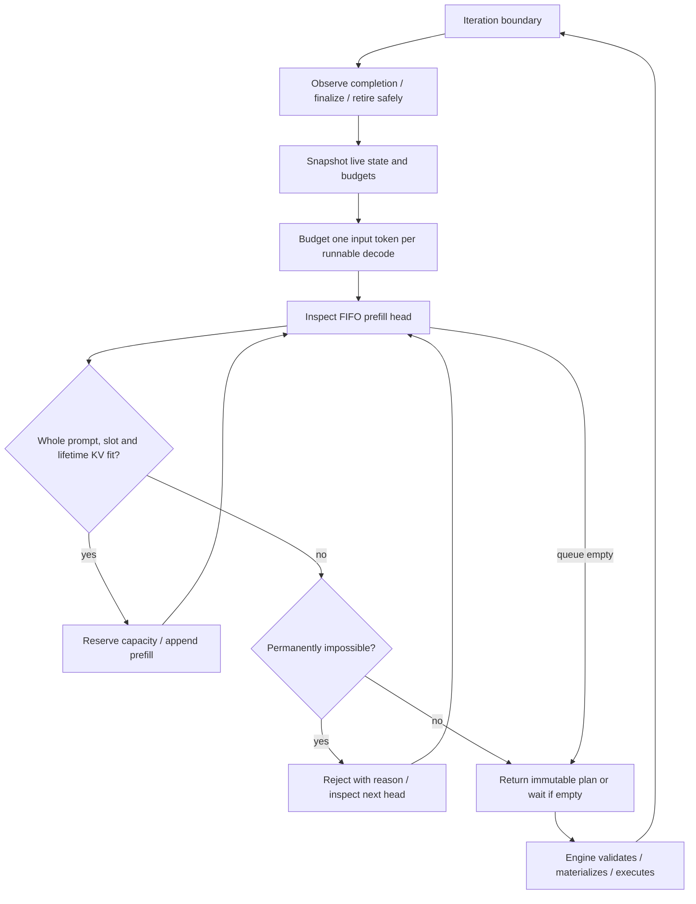

# Scheduler — planned contract

**Planned, not implemented.** This contract refines the FIFO baseline in the [runtime architecture](architecture.md). There is no runnable scheduler or verified throughput/fairness result. The engine owns execution and finalization; scheduling selects bounded work independently of HTTP and CUDA.

## Admission and capacity

Distinguish **accepting into a bounded waiting queue** from **admitting into GPU-resident execution**. Queued work holds CPU request state, not a KV reservation. Validate tokenized prompt length, requested output limit, model context limit, queue size and deadline. Reject a request that cannot fit even when the runtime is idle; delay one blocked only by current occupancy. Configure bounds for request bytes, queued requests/tokens and token event channels so overload cannot become unbounded host memory use.

The following are proposed baseline choices, rather than already implemented policies:

| Budget | Meaning / check |
| --- | --- |
| `T` | Maximum **input tokens processed** per iteration, across all micro-batches. Whole-prompt prefill costs `P`; one decode step costs one input token per selected sequence. This is not an output token limit or a GPU byte estimate. |
| `A` | Maximum resident sequence slots, including reserved prefills and sequences awaiting safe retirement. Require positive `A <= T` so all runnable resident decodes can receive a step. |
| `P + G` | Conservative lifetime cache/context bound: prompt length `P` plus requested maximum new tokens `G`. Positive validated limits; must fit the configured model context and per-request capacity. |
| KV capacity | Reserve each admitted sequence's lifetime bound, rounded to allocation units; the sum of reservations cannot exceed the dedicated KV budget. Physical storage may be populated incrementally but cannot consume another request's reservation. |

Lifetime reservation is a deliberately conservative **proposed refinement** of predicted KV allocation: it prevents accepted decodes from exhausting growth capacity because new prefills consumed it. It can lower concurrency by reserving unused future tokens. Incremental growth with preemption/offload is deferred until it has an explicit progress/recovery policy and correctness evidence. The bound may include one unused final output token; this is intentional headroom, not cache already populated. See [KV capacity and ownership](kv-cache.md).

Reject a whole prompt with `P > T` in this first policy; chunked prefill is a later extension. Model context and cache limits must be checked separately from `T`. Reservations protect accounted KV capacity, not arbitrary GPU workspace allocation: physical memory estimates still need measured margins, and OOM remains a handled failure.

## FIFO and decode progress

Use FIFO for **new prefill admission**, with an arrival-order tie breaker that is stable in CPU tests. At each iteration, eligible resident decodes receive their one-token work before new prefills use the remaining token budget. New arrivals cannot consume those decode tokens. This is the baseline interpretation of FIFO plus the design requirement that large new prefills must not starve active decode.

1. Observe completion/retirement; finalize terminal sequences once. Remove queued cancellations/expired requests and ignore terminal work.
2. Snapshot runnable state, cancellation/deadlines, available slots and KV reservations. Never schedule a sequence twice in one plan or submit overlapping work for it.
3. Select one decode input token for every runnable resident decode, charging `D` tokens for `D` sequences. Lifetime reservations already cover their growth. A temporarily blocked stream may pause that sequence without blocking other runnable work; a bounded backpressure deadline eventually cancels it.
4. Inspect new prefills in FIFO order. Reserve a resident slot and lifetime KV capacity only if the whole prompt also fits `T - D` minus already selected prefill tokens. Permanently impossible requests are rejected. Stop at a temporarily blocked head; do not silently bypass it with smaller new requests.
5. Return an immutable plan containing request identities, prefill/decode kind, input token ranges/counts, expected sequence/cache versions and reservation handles. The engine rechecks cancellation and validates the plan before device submission; abandoned work releases unused reservations.

For `T = 8`, two runnable decodes cost `2`, leaving `6` input tokens for prefill: a prompt of length `6` fits if slots/KV also fit. A FIFO head of length `7` waits while those decodes continue; a prompt of length `9` is rejected under the whole-prompt baseline. This is a scheduling example, not a performance measurement.

Strict FIFO can cause head-of-line blocking and worse TTFT for smaller queued requests. Finite generation limits and cancellation/deadline handling allow admitted work to drain, assuming a healthy executor and eventual device completion. This is not weighted fairness, a latency SLA, or a bound on wall-clock kernel time. Record queue time, TTFT, TPOT, rejection reasons and memory pressure before changing the policy. Priority/fairness, chunked prefill, deadline-aware ordering and per-tenant quotas remain later extensions; expiration checks are part of the baseline and are distinct from deadline-aware ordering.

## Iteration plan and continuous batching

The arrow back to the iteration boundary means wake on useful completion, new work, cancellation or a deadline; an empty plan must wait, not spin. Allocation or execution failure follows the [recovery contract](architecture.md#iteration-correctness-and-recovery), not an unlimited retry loop.

Continuous batching changes membership **between** iterations: finished/cancelled sequences leave, still-runnable sequences remain eligible, and newly admitted prompts can enter. Prefill and decode remain distinct work types. A materializer may split them into compatible micro-batches; all calls together must obey `T` and preserve cache/request identity. The scheduler must not assume arbitrary HF cache objects can simply be concatenated into a mixed batch.

Future CPU checks must cover deterministic ordering, exact budget edges, head-of-line waiting, simultaneous cancellations, reservation rollback, no oversubscription and no decode starvation from arrivals. Future GPU checks must establish mask/position/cache correctness and memory estimates under real batching. Those checks are requirements for implementation, not tests already present in this scaffold.
